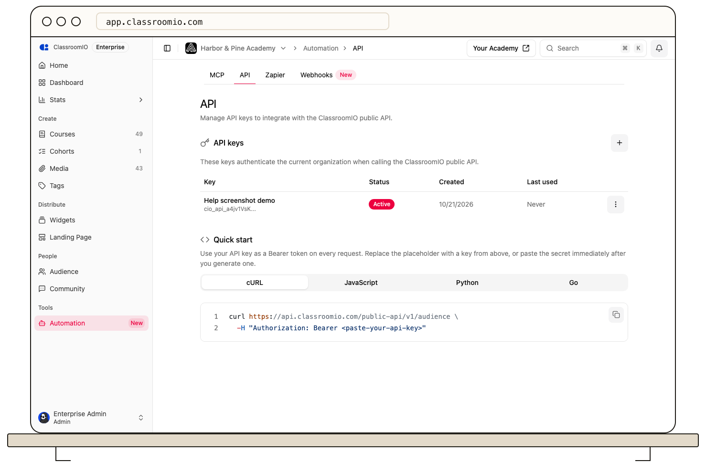

Create an organization key in **Automation → API** and store it as a server-side environment variable. Use the **API** tab's request examples or send a minimal course-list request:



```bash
printf 'Authorization: Bearer %s\n' "$CLASSROOMIO_API_KEY" |
  curl -H @- https://api.classroomio.com/public-api/v1/courses
```

The header must contain the full key, including its `cio_api_` prefix. A successful response returns course data for the key's organization according to the endpoint's permissions. The [API reference](https://classroomio.com/docs/api) documents response shapes and other routes.

For **401 Unauthorized**, check that the secret is complete, active, and sent after `Bearer`. For **403 Forbidden**, check the account's API access, the key's scope, and whether the request is allowed in that organization. A revoked or rotated key must be replaced in the calling application's secret store.

Keep requests on your server. Do not place an API key in a browser bundle or send it as a query parameter. [Manage API keys](/integrations-and-automation/create-and-manage-api-keys) explains rotation and revocation.
