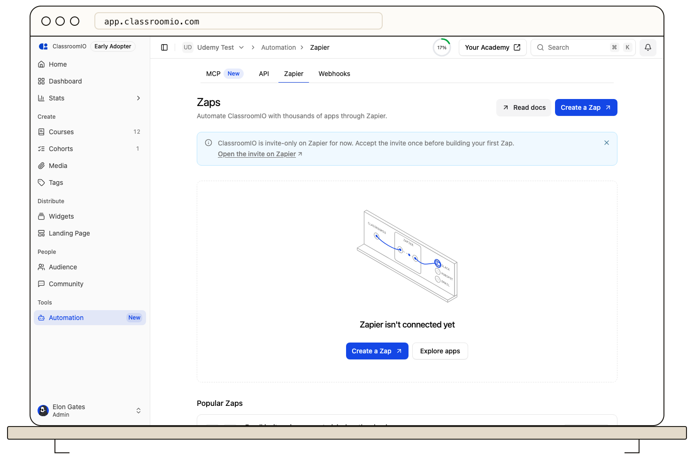

Connect ClassroomIO to Zapier to start Zaps when something happens in your organization, such as a student finishing a course, and to let Zaps enroll, update, or remove students. Only organization administrators can connect Zapier.

:::info[Plan requirement]
Zapier uses the same entitlement as the public API: Early Adopter or Enterprise on ClassroomIO cloud. It is not available on self-hosted installations.
:::

## Connect from Zapier

### 1. Add ClassroomIO to a Zap

In the Zapier editor, create a new Zap and search for **ClassroomIO** as the trigger or action app. While the integration is in private access, follow your team's private invite link to add ClassroomIO to your Zapier account.

### 2. Sign in and choose your organization

Select **Sign in** when Zapier prompts for account authorization:

1. Sign in with your ClassroomIO administrator account if you are not already signed in.
2. If you administer more than one organization, select the organization you want to connect. Organizations that are not on an eligible plan appear disabled with an upgrade prompt.

### 3. Review the permissions and allow access

The consent screen shows the ClassroomIO integration name, a **Verified** badge confirming the official integration, and the exact permission areas requested.

{/* SIGN-OFF DECISION (D4): Consent UX requests a fixed, least-privilege scope set; read-only toggle is deferred in v1. */}
Zapier requests a fixed, least-privilege permission set required to power its triggers and actions. Review the list and select **Allow** to complete the connection and return to Zapier.

## Connect from ClassroomIO

You can also start connecting directly from the ClassroomIO dashboard:

1. Open your organization and navigate to **Automation → Zapier**.
2. Select **Connect on Zapier** to open the private invite and authorize ClassroomIO. After you connect, **Create a Zap** opens the Zap editor, where you can add ClassroomIO as a trigger or action.
3. You can also browse the curated **App Directory** on the Zapier tab to discover popular workflows with apps like HubSpot, Slack, Google Sheets, and Mailchimp. Selecting an app shows sample automations and, when the connection is available, a direct link to connect.

## What Zapier can do

When you authorize Zapier, it requests access to the following areas of your organization:

| Permission area           | Access         | What it allows                                                                               |
| ------------------------- | -------------- | -------------------------------------------------------------------------------------------- |
| **Audience**              | Read and write | View learners in your organization, invite new students, and update student names or emails. |
| **Courses**               | Read only      | Read course titles, IDs, and metadata to populate course selection dropdowns in Zaps.        |
| **Course members**        | Read and write | Enroll students, send or revoke course invites, reset progress, and mark lessons complete.   |
| **Certificates**          | Read only      | Read issued certificate details, including certificate numbers and download links.           |
| **Cohorts**               | Read and write | List cohorts, add students to cohorts, and post announcements to cohort discussion feeds.    |
| **Webhook subscriptions** | Read and write | Register and manage instant trigger subscriptions so your Zaps run in real time.             |

Zapier is never granted administrative permissions: it cannot delete courses, view billing information, modify workspace settings, or manage your team administrators.

## Next steps

- [Manage Zapier connections](/integrations-and-automation/manage-zapier-connections) — View active connections, inspect active trigger subscriptions, remove access, and understand plan downgrades.
- [Zapier triggers and actions](/integrations-and-automation/zapier-triggers-and-actions) — Browse every available instant trigger, action, and search supported in ClassroomIO.
