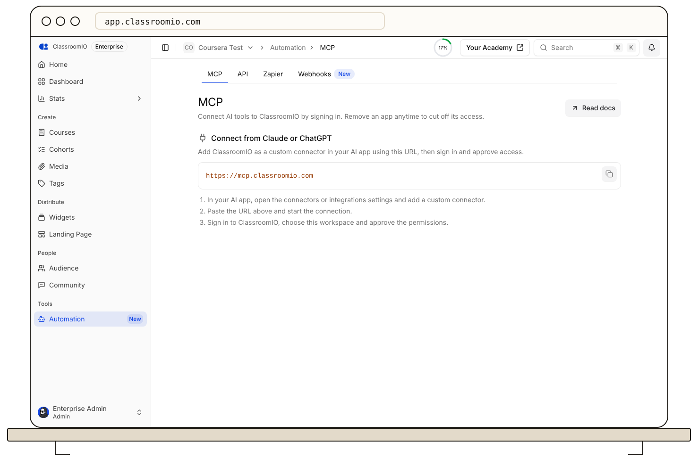

Your client connects to the hosted ClassroomIO MCP server at `https://mcp.classroomio.com` and opens a ClassroomIO sign-in page. You choose the workspace, approve the permissions, and the client receives access. You do not create or paste a key, and you do not install anything. You must be an admin of the workspace you connect.

The **Automation → MCP** page shows the connect URL and three steps until you connect your first app.



## Claude Code

Add the server, then sign in from the `/mcp` menu inside Claude Code:

```bash
claude mcp add --transport http classroomio https://mcp.classroomio.com
```

## Codex

Add the server, then sign in:

```bash
codex mcp add classroomio --url https://mcp.classroomio.com
codex mcp login classroomio
```

## Cursor

Add this entry to `~/.cursor/mcp.json`, or to `.cursor/mcp.json` for one project. Cursor shows a sign-in prompt the first time it connects.

```json
{
  "mcpServers": {
    "classroomio": {
      "url": "https://mcp.classroomio.com"
    }
  }
}
```

## OpenCode

Add a remote server to `opencode.json` in your project root, or to `~/.config/opencode/opencode.json` to make it available in every project. OpenCode starts the sign-in the first time the server needs it. You can also run `opencode mcp auth classroomio`.

```json
{
  "$schema": "https://opencode.ai/config.json",
  "mcp": {
    "classroomio": {
      "type": "remote",
      "url": "https://mcp.classroomio.com"
    }
  }
}
```

## VS Code (GitHub Copilot)

Open the Command Palette, run **MCP: Add Server**, choose **HTTP (HTTP or Server-Sent Events)**, and enter `https://mcp.classroomio.com`. Or add this to `.vscode/mcp.json` in your workspace. VS Code uses `servers` as the top-level key, not `mcpServers`. Follow the sign-in prompt when VS Code starts the server.

```json
{
  "servers": {
    "classroomio": {
      "type": "http",
      "url": "https://mcp.classroomio.com"
    }
  }
}
```

## Gemini CLI

Add the server, then run `/mcp auth classroomio` inside Gemini CLI and follow the browser prompt:

```bash
gemini mcp add --transport http --scope user classroomio https://mcp.classroomio.com
```

## Goose

Run `goose configure`, choose **Add Extension**, then **Remote Extension (Streamable HTTP)**, and enter `https://mcp.classroomio.com`. To try it in one session, run the command below. Goose obtains a client ID automatically, so complete the sign-in when it prompts you.

```bash
goose session --with-streamable-http-extension "https://mcp.classroomio.com"
```

## Factory Droid

Add the server, then run `/mcp` inside droid, select `classroomio`, and choose **Authenticate**:

```bash
droid mcp add classroomio https://mcp.classroomio.com --type http
```

## Zed

Open **Settings → AI → MCP Servers**, choose **Add Server**, then **Add Remote Server**, and point it at `https://mcp.classroomio.com`. Do not add an `Authorization` header; without one, Zed prompts you to sign in.

## Warp

Open **Settings → Agents → MCP servers**, choose **Add**, and paste the JSON below. Warp opens a browser sign-in when the server starts.

```json
{
  "mcpServers": {
    "classroomio": {
      "url": "https://mcp.classroomio.com"
    }
  }
}
```

## Other AI agents

Any client that supports remote MCP servers over Streamable HTTP with OAuth can connect. Point it at `https://mcp.classroomio.com` and sign in when it asks. A client that can only run local stdio servers cannot connect to the hosted server.

The locations and formats can change with client releases. Check the [Claude Code](https://code.claude.com/docs/en/mcp), [Codex](https://developers.openai.com/codex/mcp), [Cursor](https://cursor.com/docs/mcp), or [OpenCode](https://opencode.ai/docs/mcp-servers) documentation if your client uses a different format.

Restart or reconnect the client and check that ClassroomIO is connected. Ask it to list your courses before allowing changes. If a request is unauthorized, sign in again and confirm that you are still an admin of the workspace. You can remove a connected app under **Automation → MCP → Connected apps**. See [MCP access and limits](https://classroomio.com/docs/developers/mcp/access-and-limits).
