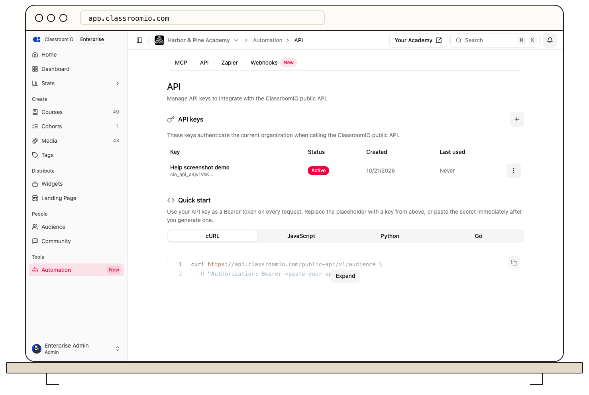

Organization administrators with public API access manage credentials under **Automation → API**. If a plan or license upgrade banner appears, API-key creation is unavailable until that requirement is met.

1. Select **Generate key**, give it a name that identifies the application, and save.
2. Copy the revealed secret immediately into a server-side secret manager. The key list later shows only a masked prefix, status, creation date, and last-use date.
3. Use it to [authenticate an API request](/integrations-and-automation/authenticate-an-api-request) and verify the application works.

Keep separate keys for separate applications. To rotate one, use its action menu, copy the new secret, update the application, and test it. Rotation replaces the old secret. To stop access, choose **Revoke** and confirm; calls using that key then fail. A lost secret cannot be retrieved, so rotate it.

API keys are tied to the organization that issued them. Do not embed one in browser code, public repositories, screenshots, or support messages. Review the [API reference](https://classroomio.com/docs/api) for supported endpoints and request schemas.
