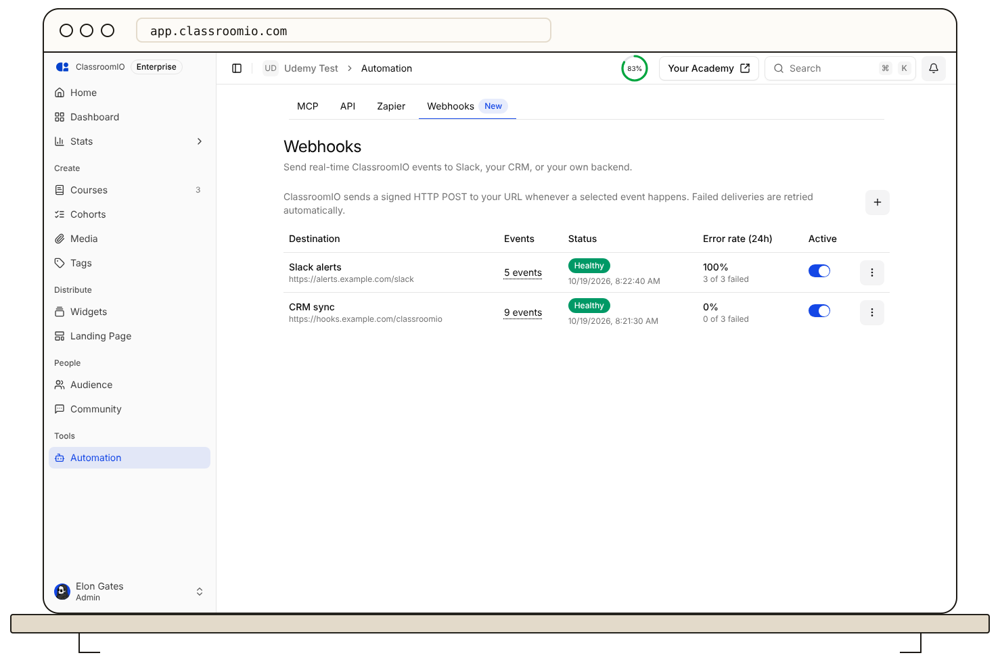
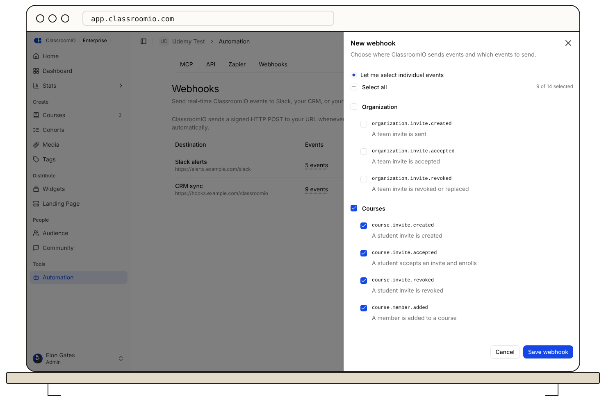
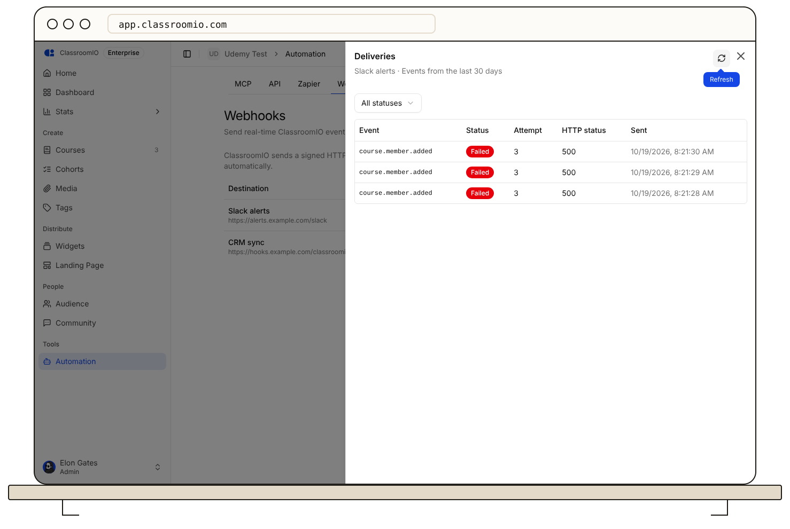
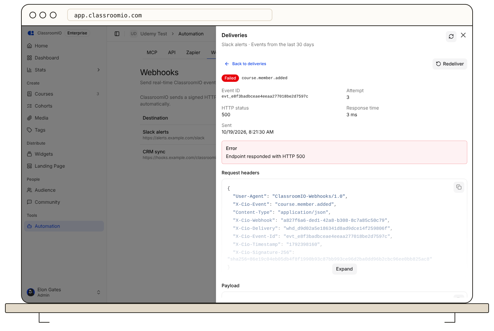

Create a webhook to have ClassroomIO send an HTTP request to a URL you control whenever something happens in your organization, such as a student finishing a course or a submission being created. Only organization administrators can create, edit, or delete webhooks.

:::info[Plan requirement]
Webhooks use the same entitlement as the public API. On ClassroomIO cloud they require the Early Adopter or Enterprise plan. Self-hosted installations require the Enterprise plan.
:::

## Before you start

- Have a public HTTPS URL that accepts a `POST` request and answers with a `2xx` status within 10 seconds. A tool such as Zapier, Make, or Slack's incoming webhooks can give you one.
- Decide which events you need. You can change them later.

## Create a webhook

### 1. Open Webhooks

From the admin dashboard, open **Automation**, then select the **Webhooks** tab.

### 2. Add the destination

Select **New webhook** (the **+** button above the table) and fill in the **Endpoint** section:

- **Name**: a label for you, such as `CRM sync`.
- **Payload URL**: where ClassroomIO sends the events.
- **Signing secret** (optional): leave it blank and ClassroomIO generates one.
- **Verify SSL certificate**: keep this on unless you are testing against a self-signed certificate.
- **Active**: turn this off to create the webhook without sending any events yet.

### 3. Choose the events

Under **Events**, choose **Send me everything** to receive every event, now and in the future, or **Let me select individual events**.

Select the checkbox next to a group (**Organization**, **Courses**, or **Learning progress**) to turn on all of its events, or tick single events. **Select all** toggles every event, and the counter shows how many are selected.

### 4. Save and copy the signing secret

Select **Save webhook**. ClassroomIO shows the signing secret once. Copy it, store it where your server can read it, then select **I saved it**. You can't view the secret again, but you can replace it later with **Regenerate secret**.

Your server uses the secret to confirm that a request really came from ClassroomIO. The developer documentation explains the [signature check and the payload of every event](https://classroomio.com/docs/developers/webhooks).

### 5. Send a test event

Open the **⋮** menu on the webhook and select **Send test event**. The test appears in the delivery history with a **Test** label. It never counts toward the webhook's health.

## Check the status of a webhook

The webhooks table shows how each destination is doing:

| Status            | Meaning                                                                     |
| ----------------- | --------------------------------------------------------------------------- |
| **Healthy**       | Recent deliveries are succeeding.                                           |
| **Retrying**      | The first deliveries are failing and ClassroomIO is trying again.           |
| **Failing**       | 20 deliveries in a row have failed.                                         |
| **Auto-disabled** | 100 deliveries in a row have failed, so ClassroomIO turned the webhook off. |

The **Error rate (24h)** column shows how many deliveries failed in the last 24 hours. ClassroomIO also emails every organization administrator when a webhook becomes **Failing** and again when it is auto-disabled.

## Find and resend a delivery

### 1. Open the delivery history

Open the **⋮** menu on the webhook and select **View deliveries**. The list shows events from the last 30 days. Use **All statuses** to show only successful, retrying, or failed deliveries.

### 2. Open a delivery

Select a row to see its HTTP status, response time, the error, the request headers, the payload, and the response your server returned.

### 3. Redeliver it

Select **Redeliver** to send the same event again after you fix your server. The resent event keeps its original event ID, so your server can recognize it.

## How failed deliveries are retried

ClassroomIO tries a failed delivery up to six times: right away, then after 10 seconds, 1 minute, 5 minutes, 30 minutes, and 2 hours. After the last attempt the delivery is marked **Failed**. Redirects are not followed and count as failures.

## Pause, edit, or delete a webhook

- **Pause**: use the **Active** switch in the table. A paused webhook receives no new events, and a retry that comes due while it is paused is marked **Failed** and is not resumed when you turn the webhook back on. Redeliver those events from the delivery history.
- **Re-enable an auto-disabled webhook**: fix your server, then turn the **Active** switch back on. This resets its failure count.
- **Edit**: open the **⋮** menu and select **Edit** to change the name, URL, events, or other settings.
- **Regenerate secret**: open the **⋮** menu and select **Regenerate secret**. The old secret stops working immediately, so update your server first or right after.
- **Delete**: open the **⋮** menu and select **Delete**. The webhook and its delivery history are removed.

## Troubleshooting

### My server receives requests, but they are marked Failed

ClassroomIO treats any response outside `2xx` as a failure. Open the delivery to read the HTTP status and the response your server returned.

### I don't get an event I expected

Open **Edit** and check that the event is selected. If you chose **Let me select individual events**, new event types are not added automatically.

### I can't save my Payload URL

Cloud organizations need a public HTTPS URL. Addresses on a private network and `localhost` are rejected.

## Related guides

- [Understand ClassroomIO integrations](/integrations-and-automation/understand-classroomio-integrations) — compare webhooks with the API and MCP.
- [Webhook developer documentation](https://classroomio.com/docs/developers/webhooks) — event payloads and signature verification.
