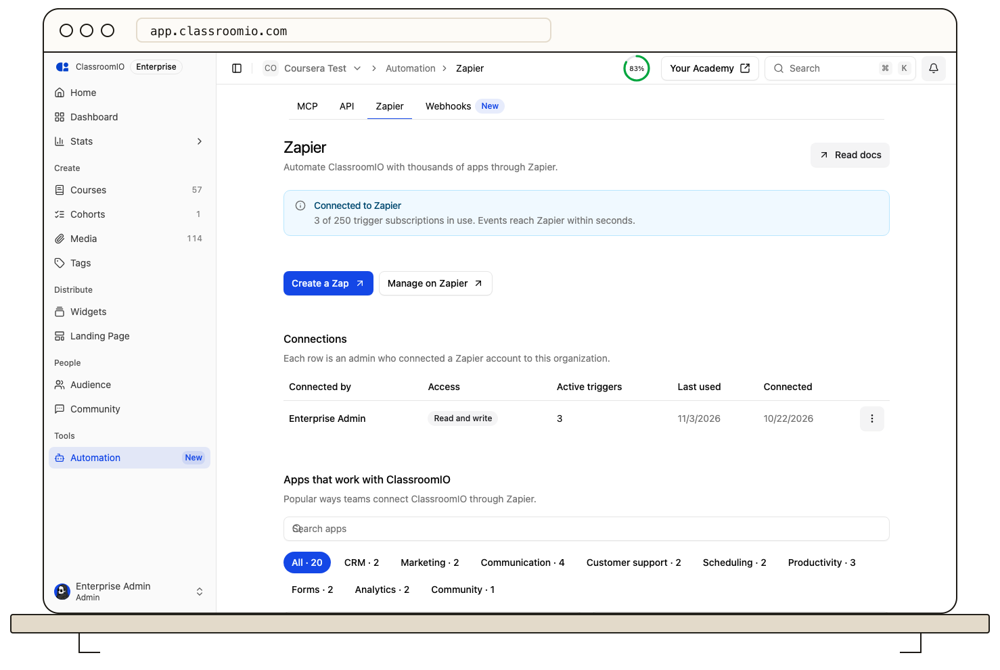

Organization administrators can see the Zapier connection, disconnect it, and resend events that did not reach Zapier from the ClassroomIO dashboard.

:::info[Plan requirement]
Connecting Zapier requires an Early Adopter or Enterprise plan on ClassroomIO cloud. Administrators on other plans can still review and remove existing connections.
:::

## Your Zapier connection

Open **Automation** in the admin dashboard and select the **Zapier** tab. The **Connection** section lists each Zapier account an administrator connected to this organization:

- **Access**: **Read and write**, or **Read only** when the administrator turned off **Allow Zapier to make changes** while connecting.
- **Connected by**: the administrator who connected the account and the date, or **a former admin** when they are no longer part of the organization.

Your Zaps, their steps and their run history live on Zapier. Select **My Zaps** to open them, or **Explore apps** next to **Popular Zaps** to browse the App Directory for more Zaps to build.

## Resend events that did not reach Zapier

ClassroomIO sends events to Zapier the moment they happen and retries failed deliveries for about 2.6 hours. When events from the last 24 hours still failed, the Zapier tab shows **Some events didn't reach Zapier**. Select **Resend failed events** to send them again.

## Disconnect Zapier

You can disconnect a Zapier account at any time if it is no longer needed, during employee offboarding, or as a security precaution:

1. In the **Connection** section, select **Disconnect**.
2. A confirmation dialog explains that Zaps using the connection stop and how many active triggers are removed.
3. Select **Disconnect** to confirm.

When you disconnect:

- The connection's OAuth tokens are invalidated immediately.
- Its triggers stop receiving events and are removed.
- Any active Zaps in Zapier using this connection stop receiving triggers and fail with authorization errors if they attempt to run actions.
- The connection stays listed in your Zapier account. ClassroomIO can't remove it there, so select **Open Zapier connections** in the dialog and delete it in Zapier too.

To reconnect, select **Create a Zap** on the Zapier tab or reconnect ClassroomIO inside Zapier.

## What happens on a plan downgrade

{/* SIGN-OFF DECISION (D7): Plan downgrade pauses connections rather than revoking them immediately. Upgrading restores them without reconnecting. */}
If your organization moves below the Early Adopter plan (for example, switching to the Basic plan):

- Connected Zapier accounts are **paused, not deleted**.
- Requests made by Zapier actions fail with an `UPGRADE_REQUIRED` error.
- Event trigger deliveries to Zapier are suspended while the plan is ineligible.
- The Zapier tab shows **Zapier is paused**.

When you upgrade back to Early Adopter or Enterprise, your connections automatically unpause and resume delivering events without requiring you to reconnect accounts or re-configure field mappings in Zapier.

## When an administrator leaves the organization

OAuth connections are bound to the administrator account that authorized them:

- If that administrator is demoted to a tutor or student role, or is removed from the organization, their OAuth connections and tokens are deleted immediately for security.
- Any Zaps connected under that administrator will pause or fail until a current administrator re-authorizes the connection in Zapier.

**Best practice:** When planning team changes, have another administrator re-authorize the connection in Zapier before removing the departing administrator.

## Troubleshooting

### Zapier prompts to reconnect

Refresh tokens expire after 90 days of inactivity. If your Zaps have not made requests or received events in 90 days, or if the authorizing administrator's account was modified, Zapier prompts you to reconnect. Select **Reconnect** in Zapier and complete the sign-in prompt.

### 403 Forbidden or "Plan doesn't include Zapier"

Zapier requires an active Early Adopter or Enterprise plan on ClassroomIO cloud. Check your subscription under **Settings → Billing**. If the plan was recently downgraded, upgrade to restore integration access.

### "This ClassroomIO connection is read-only"

The connection was made with **Allow Zapier to make changes** turned off, so it can run triggers and searches but not actions. Reconnect ClassroomIO in Zapier and leave the switch on.

### 429 Too Many Requests (Rate limits)

Zapier requests are rate limited per organization, not per connection: Early Adopter allows 120 reads and 40 writes per minute, and Enterprise allows 360 reads and 120 writes per minute. If you run high-volume Zaps that process hundreds of items simultaneously, add delay steps in Zapier or batch operations to remain within the rate limit.

Invites have their own limit: the admin who connected Zapier can create invites for one course 60 times per hour. **Send Course Invite**, **Enroll Student in Course** when it has to invite someone new, and that admin's invites from the dashboard all count toward it. Enrolling someone who is already enrolled or invited doesn't count.

### Missing trigger events

ClassroomIO retries a failed webhook delivery 5 times over about 2.6 hours (6 attempts in total) before marking it failed. If an event did not trigger your Zap:

1. If the Zapier tab shows **Some events didn't reach Zapier**, select **Resend failed events**.
2. Confirm in Zapier that your Zap is turned **On**.
3. Check your Zap history in Zapier to verify whether Zapier received the event or experienced an execution error.

### Avoiding infinite loops

If a Zap performs an action in ClassroomIO that triggers another Zap (for example, Zap A enrolls a student, which fires the _New Course Enrollment_ trigger for Zap B), an event loop can occur.

Every ClassroomIO enrollment event includes `source.oauthClientId` in its data payload. In Zapier, you can add a **Filter** step that ignores events where `source.oauthClientId` matches your Zapier integration to prevent accidental loops.
