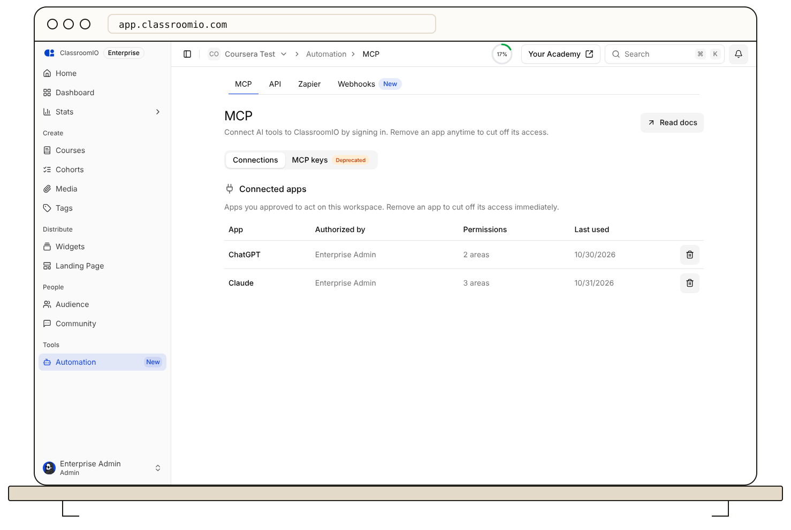

ClassroomIO provides several connection paths. Choose by the job you need to do and grant credentials only to trusted systems.

- **MCP** connects an AI client such as Claude Code, Codex, Cursor, or OpenCode to ClassroomIO tools. Use it for assisted course work and other supported actions. Start with [ClassroomIO MCP](/integrations-and-automation/understand-classroomio-mcp).
- **Public API** lets your own application make authenticated requests. Create a key under **Automation → API**, then follow the [API request guide](/integrations-and-automation/authenticate-an-api-request).
- **Webhooks** send event notifications to an endpoint you control. Use [webhook setup](/integrations-and-automation/create-and-manage-webhooks) when your app should react to ClassroomIO events.
- **SSO** connects an identity provider for academy sign-in. [Set up enterprise SSO](/integrations/enterprise-sso-setup) when your organization manages accounts centrally.
- **Token Auth** hands a signed-in user from your application to ClassroomIO. It is an Enterprise feature; see [Token Auth setup](/account-team-security/set-up-token-based-authentication).
- **Embeds and widgets** put course discovery or content on another site. See [embed a course widget](/publish-and-brand/embed-a-widget-on-another-website).

MCP and API keys belong to one organization. Keep them in a secret manager, check the creator's permissions, and revoke unused credentials. For endpoint schemas and developer examples, open the [developer documentation](https://classroomio.com/docs/developers).
