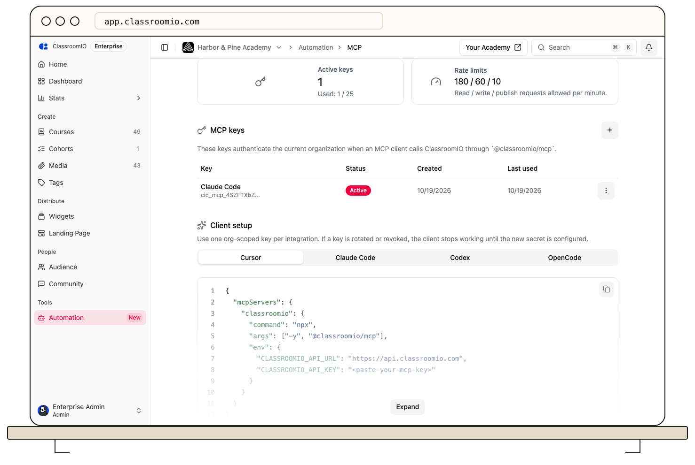

Model Context Protocol (MCP) lets an AI client use ClassroomIO tools through the `@classroomio/mcp` server. The client plans the work; the server validates tool input and forwards authenticated requests to the ClassroomIO API.

MCP supports draft-based course authoring and work with courses, exercises, cohorts, audience, and analytics. Creating a draft and publishing it are separate steps, so review draft content before publication. See [MCP access and limits](https://classroomio.com/docs/developers/mcp/access-and-limits) before connecting a client.

An organization administrator creates an MCP key under **Automation → MCP**. The key identifies the organization; its scopes and the creator's permissions limit what requests can do. ClassroomIO checks those permissions at the API. A key is not a way to bypass a user's course role.

Only connect a trusted AI client. The client may receive course or student data returned by tools, so review the client's data-handling rules before granting access. [Create an MCP key](/integrations-and-automation/create-rotate-and-revoke-mcp-keys), then [connect your client](/integrations-and-automation/connect-claude-code-codex-cursor-or-opencode). Revoke the key when the connection is no longer needed.
