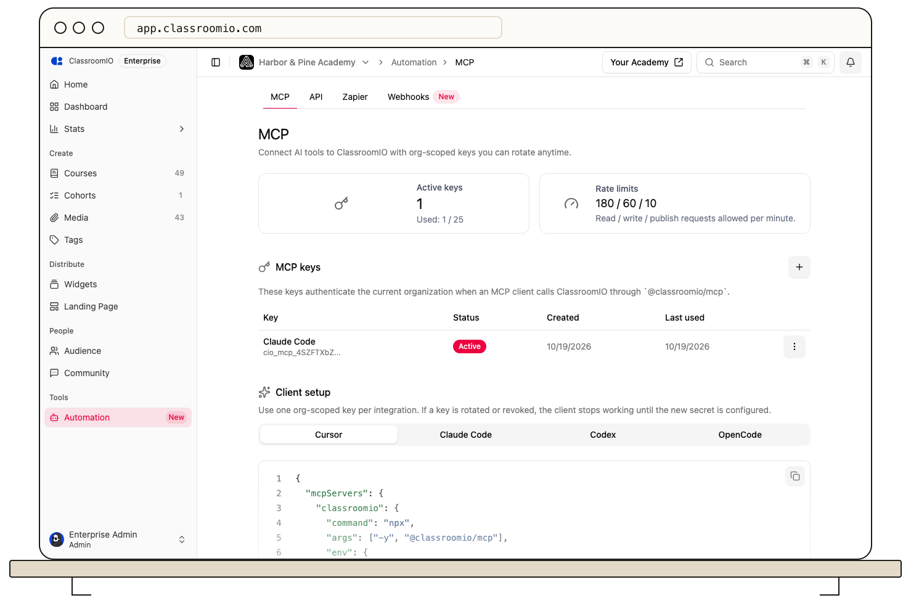

An MCP key belongs to one organization and has explicit scopes. ClassroomIO verifies the key, resolves its organization, and checks the scopes for each request. Course and organization permissions still apply to the person who created the key. A key created by a tutor does not give that tutor administrator access.

MCP can read and change supported course, cohort, learner, and organization data within the key's access. Review [MCP access and limits](https://classroomio.com/docs/developers/mcp/access-and-limits) before connecting a client. Use separate keys for separate clients so each can be rotated or revoked independently.

**Automation → MCP** displays the current active-key allowance and per-key read, write, and publish rate limits. Check that live display rather than relying on a fixed number in a guide. Analytics reads do not consume AI credits; other AI-related product actions may have their own credit rules.

A client can expose data returned by permitted tools to its operator. Limit who can use the client, inspect proposed writes before publication, and [revoke a key](/integrations-and-automation/create-rotate-and-revoke-mcp-keys) when it is no longer needed.
