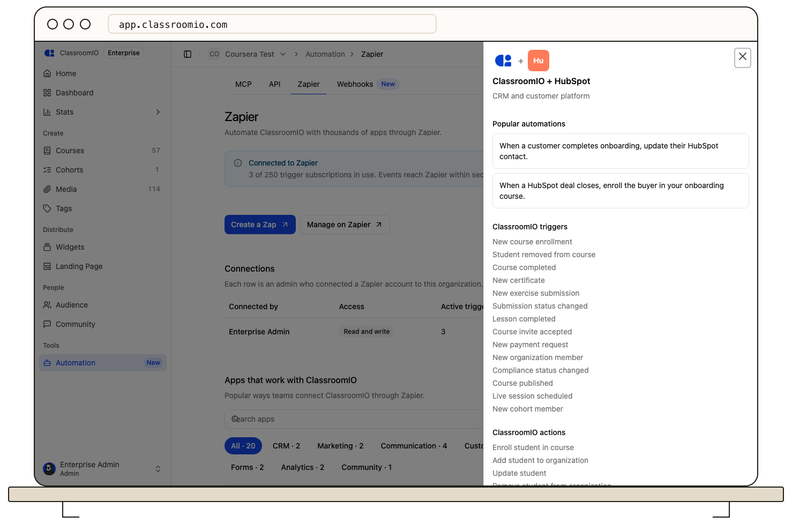

The ClassroomIO Zapier app provides instant triggers and actions to connect your academy to thousands of tools like CRMs, spreadsheets, messaging apps, and email platforms without writing code.

:::info[Plan requirement]
Zapier triggers and actions require an Early Adopter or Enterprise plan on ClassroomIO cloud.
:::

ClassroomIO triggers are **instant**: they use real-time REST hooks backed by ClassroomIO's webhook engine rather than polling on a schedule. Your Zaps run within seconds of an event occurring in your academy.

:::note[Delivery and retries]
If your Zap's hook endpoint is unreachable, ClassroomIO retries the event for about 2.6 hours (6 attempts). After the last attempt the delivery is marked failed. Admins are not emailed about Zapier deliveries. Instead, while failures from the last 24 hours are recorded, **Automation › Zapier** shows one of two warnings:

- **Some events didn't reach Zapier**: events from the last 24 hours failed while the trigger is still active. Select **Resend failed events** to send them again.
- **Some triggers are disabled**: ClassroomIO turned the trigger off after repeated delivery failures, so there is nothing to resend. Fix the receiving end in Zapier, then turn the Zap off and back on to resubscribe the trigger.

:::

Every trigger returns the event fields listed below plus the shared envelope fields `id`, `event_type`, `occurred_at`, and `organization`. Course events also include a `links` object with three labelled URLs: **Admin Course URL** (the course in your dashboard), **Student Course URL** (the learner's course view), and **Course Landing Page URL** (the public course page, filled only when the course is published and has a slug). Organization and cohort events label the first two **Admin URL** and **Student URL**, and their landing URL is empty.

---

## Instant triggers

### 1. New Course Enrollment

- **Key**: `new_course_enrollment`
- **When it fires**: A student is added to a course, however they joined.
- **Inputs**:
  - `Course`: Only trigger for this course. Leave empty for every course.
  - `How They Joined`: Only trigger for the selected join methods (`invite`, `invite_link`, `self_enroll`, `admin`, `api`, `import`, `sso`, `payment`, or `cohort`).
- **Outputs**: `courseId`, `memberId`, `profileId`, `email`, `roleId`, `role`, `enrolledAt`, `actorProfileId`, `actor`, `links`, `course.*`, `student.*`, `source.method`, `source.inviteId`, `source.inviteLinkId`, `source.cohortId`, `source.programId`, `source.apiKeyId`, `source.oauthClientId`.

### 2. Student Removed From Course

- **Key**: `course_member_removed`
- **When it fires**: A student is removed from a course.
- **Inputs**: `Course` (optional).
- **Outputs**: `courseId`, `memberId`, `profileId`, `email`, `roleId`, `role`, `enrolledAt`, `actorProfileId`, `actor`, `reason`, `progressAtRemoval.percent`, `progressAtRemoval.completed`, `progressAtRemoval.lastActiveAt`, `links`, `course.*`, `student.*`.

### 3. Course Completed

- **Key**: `course_completed`
- **When it fires**: A student completes every required lesson in a course.
- **Inputs**: `Course` (optional).
- **Outputs**: `courseId`, `memberId`, `profileId`, `completedAt`, `enrolledAt`, `startedAt`, `score`, `attempts`, `timeSpentMinutes`, `progress.lessonsCompleted`, `progress.lessonsTotal`, `progress.exercisesCompleted`, `progress.exercisesTotal`, `progress.percent`, `compliance`, `links`, `course.*`, `student.*`.

### 4. New Certificate

- **Key**: `new_certificate`
- **When it fires**: A course completion certificate is issued to a student.
- **Inputs**: `Course` (optional).
- **Outputs**: `courseId`, `memberId`, `profileId`, `completedAt`, `certificate.id`, `certificate.displayId`, `certificate.issuedAt`, `certificate.expiresAt`, `certificate.cycleNumber`, `certificate.status`, `certificate.downloadUrl`, `certificate_file`, `progress.*`, `links`, `course.*`, `student.*`.

`certificate_file` is a hydrated file you can pass to a file upload action.

### 5. New Exercise Submission

- **Key**: `new_submission`
- **When it fires**: A student submits an exercise.
- **Inputs**: `Course` (optional).
- **Outputs**: `courseId`, `submissionId`, `exerciseId`, `memberId`, `profileId`, `statusId`, `status`, `gradingState`, `total`, `percentage`, `passed`, `attemptNumber`, `overallStatus`, `submittedAt`, `gradedAt`, `isLate`, `reviewer`, `links`, `course.*`, `exercise.*`, `student.*`.

### 6. Submission Status Changed

- **Key**: `submission_status_changed`
- **When it fires**: A submission is graded or its grading status changes.
- **Inputs**: `Course` (optional).
- **Outputs**: `courseId`, `submissionId`, `exerciseId`, `memberId`, `profileId`, `statusId`, `status`, `gradingState`, `total`, `previousStatusId`, `previousStatus`, `previousGradingState`, `percentage`, `passed`, `attemptNumber`, `overallStatus`, `submittedAt`, `gradedAt`, `isLate`, `actorProfileId`, `actor`, `reviewer`, `links`, `course.*`, `exercise.*`, `student.*`.

### 7. Lesson Completed

- **Key**: `lesson_completed`
- **When it fires**: A student marks a lesson complete.
- **Inputs**: `Course` (optional).
- **Outputs**: `courseId`, `lessonId`, `profileId`, `memberId`, `isComplete`, `lesson.id`, `lesson.title`, `lesson.section.id`, `lesson.section.title`, `courseProgress.lessonsCompleted`, `courseProgress.lessonsTotal`, `courseProgress.exercisesCompleted`, `courseProgress.exercisesTotal`, `courseProgress.percent`, `links`, `course.*`, `student.*`.

### 8. Course Invite Accepted

- **Key**: `course_invite_accepted`
- **When it fires**: Someone accepts a course invite, or joins a course through its invite link. It also fires once for each course on an organization invite when that invite is accepted; `inviteId` is then the organization invite id, and `roleId`, `role`, `expiresAt`, `maxUses`, `usedCount` and `allowedDomains` are empty.
- **Inputs**: `Course` (optional).
- **Outputs**: `courseId`, `inviteId`, `inviteLinkId`, `email`, `actorProfileId`, `roleId`, `role`, `expiresAt`, `maxUses`, `usedCount`, `allowedDomains`, `links`, `course.*`, `actor.*`.

### 9. New Payment Request

- **Key**: `new_payment_request`
- **When it fires**: A learner submits a payment request for a paid course.
- **Inputs**: `Course` (optional).
- **Outputs**: `courseId`, `profileId`, `email`, `studentName`, `links`, `course.*`, `student.*`.

`profileId` and `student.id` are `null` when the requester is not a member yet.

### 10. New Organization Member

- **Key**: `new_organization_member`
- **When it fires**: Someone joins the organization as a student, tutor, or admin.
- **Inputs**: `Role` (optional; `student`, `tutor`, or `admin`).
- **Outputs**: `memberId`, `profileId`, `email`, `roleId`, `role`, `status`, `actorProfileId`, `member.id`, `member.name`, `member.email`, `member.externalId`, `actor.*`, `links`.

### 11. Compliance Status Changed

- **Key**: `compliance_status_changed`
- **When it fires**: A learner's compliance status changes, for example to overdue or expired.
- **Inputs**: `Course` (optional).
- **Outputs**: `courseId`, `recordId`, `memberId`, `profileId`, `cycleNumber`, `actorProfileId`, `status`, `previousStatus`, `trigger`, `dueDate`, `validUntil`, `actor`, `links`, `course.*`, `student.*`.

### 12. Course Published

- **Key**: `course_published`
- **When it fires**: A course is published.
- **Inputs**: None.
- **Outputs**: `courseId`, `actorProfileId`, `actor`, `links`, `course.*`.

### 13. Live Session Scheduled

- **Key**: `live_session_scheduled`
- **When it fires**: A live session is scheduled or rescheduled.
- **Inputs**: `Course` (optional).
- **Outputs**: `courseId`, `lessonId`, `startsAt`, `previousStartsAt`, `callUrl`, `actorProfileId`, `lesson.id`, `lesson.title`, `actor`, `links`, `course.*`.

### 14. New Cohort Member

- **Key**: `new_cohort_member`
- **When it fires**: A student is added to a cohort.
- **Inputs**: `Cohort` (optional).
- **Outputs**: `cohortId`, `memberId`, `profileId`, `email`, `roleId`, `role`, `actorProfileId`, `cohort.id`, `cohort.name`, `actor`, `links`, `student.*`.

---

## Actions

All create actions that take a student accept the student's email address, not a member ID.

### 1. Enroll Student in Course

- **Key**: `enroll_student`
- **Description**: Enrolls a student in a course by email, inviting them first if they are new.
- **Inputs**:
  - `Course` (required).
  - `Student Email` (required).
  - `Send Email` (optional, defaults to on).
- **Outputs**: `status`, `memberId`, `inviteId`, `inviteKind`, `inviteLink`, `email`. When the student is invited, `inviteId` is their organization invite, which carries this course, and `inviteKind` is `organization`.
- **Repeat behavior**: If the student is already enrolled or invited, the action succeeds without duplicating records. With **Send Email** on, a repeat sends the invitation email if it was never sent. If the email can't be queued the step fails, but the invitation is kept, so a retry sends it.

### 2. Add Student to Organization

- **Key**: `add_student`
- **Description**: Invites a student to your organization without enrolling them in a course.
- **Inputs**:
  - `Student Email` (required).
  - `Send Email` (optional, defaults to on).
- **Outputs**: `id`, `profileId`, `name`, `email`.
- **Repeat behavior**: If the student has already joined, returns the existing record. If they have an invite that hasn't been accepted, the invite is renewed and re-sent, and the existing record is returned. Renewing a pending invite keeps its seat; renewing one that expired or was revoked takes a free student seat, and the step fails if your plan has no seats left.

### 3. Update Student

- **Key**: `update_student`
- **Description**: Updates a student's name, or the email of an invite that hasn't been accepted.
- **Inputs**:
  - `Current Email` (required).
  - `New Name` (optional; applies to students who have joined).
  - `New Email` (optional; applies to invites that haven't been accepted).
- **Outputs**: `id`, `profileId`, `name`, `email`, `avatarUrl`, `createdAt`, `status`, `memberStatus`, `lastLoginAt`, `lastActiveAt`, `enrolledCount`, `completedCount`, `progressPercent`, `certificateCount`.
- **Repeat behavior**: Updates the profile or pending invite in place. Fill in `New Name` for a joined student, or `New Email` for a pending invite. Changing the email of an invite that expired or was revoked renews it, which needs a free student seat.

### 4. Remove Student From Organization

- **Key**: `remove_student`
- **Description**: Removes a student from your organization and all of its courses.
- **Inputs**: `Student Email` (required).
- **Outputs**: `id`, `organizationId`, `roleId`, `profileId`, `email`, `verified`, `status`, `statusChangedAt`, `statusChangedBy`, `lastActiveAt`, `createdAt`.
- **Repeat behavior**: Removes the member. An already-removed student returns not found.

### 5. Remove Student From Course

- **Key**: `remove_course_member`
- **Description**: Removes a student from one course and keeps them in your organization.
- **Inputs**: `Course` (required), `Student Email` (required).
- **Outputs**: `id`, `groupId`, `roleId`, `profileId`, `email`, `createdAt`, `assignedStudentId`, `certificateEarnedAt`, `certificationEmailSentAt`.
- **Repeat behavior**: Removes the enrollment for that course. A student who is not enrolled returns not found.

### 6. Send Course Invite

- **Key**: `send_course_invite`
- **Description**: Emails an invite to join a course.
- **Inputs**: `Course` (required), `Emails` (required list; each address gets the course on its organization invite, and people who already joined are enrolled).
- **Outputs**: `recipients[]` (`email`, `status`, `inviteId`, `inviteKind`, `inviteLink`), `mode`, `invites` (always empty), `inviteLink` (always empty), `duplicatesSkipped`, `delivery.requested`, `delivery.sent`, `delivery.failed`, `delivery.failures`.
- **Repeat behavior**: Sends a fresh invite link to each address that has not joined; people who already joined are enrolled instead. The new link replaces the previous one, so the address keeps a single invite and the older link opens the newest invite. An address repeated within one request is invited once. A malformed address fails the step before anyone is invited. If an address belongs to staff or an archived member, or would exceed your student seats, the step fails after the other addresses were already invited; remove the failing address before replaying. Use **Enroll Student in Course** when repeats should change nothing.

### 7. Revoke Course Invite

- **Key**: `revoke_course_invite`
- **Description**: Removes this course from a pending invite, or cancels a course invite link so it stops working.
- **Inputs**: `Course` (required), `Invite` (required). Pick an invite link, or pass an organization invite id from **Send Course Invite** or **Enroll Student in Course** to remove just this course from it. The invite keeps its other courses and cohorts and is revoked only when nothing is left on it.
- **Outputs**: `id`, `status`, `isRevoked`.
- **Repeat behavior**: Revokes the invite. Revoking an already-revoked invite succeeds and changes nothing; only an invite that no longer exists returns not found. An organization invite that was already accepted returns a conflict error.

### 8. Reset Student Course Progress

- **Key**: `reset_course_progress`
- **Description**: Clears a student's progress in a course and keeps them enrolled. This can't be undone.
- **Inputs**: `Course` (required), `Student Email` (required).
- **Outputs**: `lessonCompletion`, `lessonVideoProgress`, `submissions`, `groupAttendance`, `lessonComments`, `courseNewsfeed`, `courseNewsfeedComments`, `courseCertificateIssues`, `courseCompletionRecords`, `aiChatConversations`.
- **Repeat behavior**: Resets completed lessons and progress records back to zero.

### 9. Mark Lesson Complete

- **Key**: `mark_lesson_complete`
- **Description**: Marks a lesson complete for a student.
- **Inputs**: `Course` (required), `Lesson` (required), `Student Email` (required).
- **Outputs**: `lessonId`, `memberId`, `isComplete`, `updatedAt`.
- **Repeat behavior**: Idempotent. Completing an already completed lesson stays complete.

### 10. Add Student to Cohort

- **Key**: `add_cohort_member`
- **Description**: Adds a student to a cohort. A student who has not joined your organization is emailed an organization invite carrying the cohort, which takes a student seat.
- **Inputs**: `Cohort` (required), `Student Email` (required), `Name` (optional).
- **Outputs**: `added[]` (`id`, `cohortId`, `profileId`, `roleId`, `email`, `createdAt`), `invited[]` (`index`, `email`, `status` = `invited`, `already_invited`, `enrolled` or `already_enrolled`, `inviteId`), `errors[]`. An admin or tutor email fails the step.
- **Repeat behavior**: Re-running for an existing member fails with "already a member". Repeating an invite reports `already_invited`.

### 11. Post to Cohort Feed

- **Key**: `post_cohort_announcement`
- **Description**: Posts an announcement to a cohort's feed.
- **Inputs**: `Cohort` (required), `Message` (required), `Pin Post` (optional).
- **Outputs**: `id`, `createdAt`, `authorId`, `cohortId`, `content`, `reaction`, `isPinned`.
- **Repeat behavior**: Creates a new announcement post in the cohort feed.
