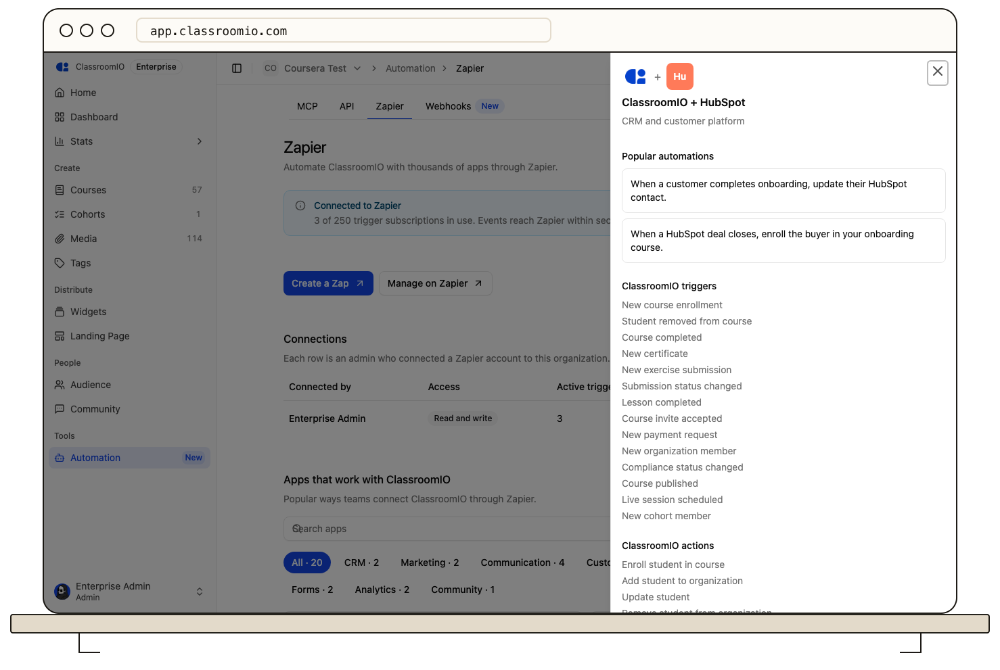

The ClassroomIO Zapier app provides instant triggers, actions, and searches to connect your academy to thousands of tools like CRMs, spreadsheets, messaging apps, and email platforms without writing code.

:::info[Plan requirement]
Zapier triggers and actions require an Early Adopter or Enterprise plan on ClassroomIO cloud.
:::

ClassroomIO triggers are **instant**: they use real-time REST hooks backed by ClassroomIO's webhook engine rather than polling on a schedule. Your Zaps run within seconds of an event occurring in your academy.

:::note[Delivery and retries]
If your Zap's hook endpoint is unreachable, ClassroomIO retries the event for about 2.6 hours (6 attempts). After the last attempt the delivery is marked failed, and organization admins are emailed when deliveries keep failing. From **Automation › Zapier** an admin can redeliver the last 24 hours of failed events for a trigger.
:::

Every trigger returns the event fields listed below plus the shared envelope fields `id`, `event_type`, `occurred_at`, and `organization`.

---

## Instant triggers

### 1. New Course Enrollment

- **Key**: `new_course_enrollment`
- **When it fires**: A student is added to a course, however they joined.
- **Inputs**:
  - `Course`: Only trigger for this course. Leave empty for every course.
  - `How They Joined`: Only trigger for the selected join methods (`invite`, `invite_link`, `self_enroll`, `admin`, `api`, `import`, `sso`, `payment`, or `cohort`).
- **Outputs**: `courseId`, `memberId`, `profileId`, `email`, `roleId`, `role`, `enrolledAt`, `actorProfileId`, `actor`, `links`, `course.*`, `student.*`, `source.method`, `source.inviteId`, `source.inviteLinkId`, `source.cohortId`, `source.programId`, `source.apiKeyId`, `source.oauthClientId`.

### 2. Student Removed From Course

- **Key**: `course_member_removed`
- **When it fires**: A student is removed from a course.
- **Inputs**: `Course` (optional).
- **Outputs**: `courseId`, `memberId`, `profileId`, `email`, `roleId`, `role`, `enrolledAt`, `actorProfileId`, `actor`, `reason`, `progressAtRemoval.percent`, `progressAtRemoval.completed`, `progressAtRemoval.lastActiveAt`, `links`, `course.*`, `student.*`.

### 3. Course Completed

- **Key**: `course_completed`
- **When it fires**: A student completes every required lesson in a course.
- **Inputs**: `Course` (optional).
- **Outputs**: `courseId`, `memberId`, `profileId`, `completedAt`, `enrolledAt`, `startedAt`, `score`, `attempts`, `timeSpentMinutes`, `progress.lessonsCompleted`, `progress.lessonsTotal`, `progress.exercisesCompleted`, `progress.exercisesTotal`, `progress.percent`, `compliance`, `links`, `course.*`, `student.*`.

### 4. New Certificate

- **Key**: `new_certificate`
- **When it fires**: A course completion certificate is issued to a student.
- **Inputs**: `Course` (optional).
- **Outputs**: `courseId`, `memberId`, `profileId`, `completedAt`, `certificate.id`, `certificate.displayId`, `certificate.issuedAt`, `certificate.expiresAt`, `certificate.cycleNumber`, `certificate.status`, `certificate.downloadUrl`, `certificate_file`, `progress.*`, `links`, `course.*`, `student.*`.

`certificate_file` is a hydrated file you can pass to a file upload action.

### 5. New Exercise Submission

- **Key**: `new_submission`
- **When it fires**: A student submits an exercise.
- **Inputs**: `Course` (optional).
- **Outputs**: `courseId`, `submissionId`, `exerciseId`, `memberId`, `profileId`, `statusId`, `status`, `gradingState`, `total`, `percentage`, `passed`, `attemptNumber`, `overallStatus`, `submittedAt`, `gradedAt`, `isLate`, `reviewer`, `links`, `course.*`, `exercise.*`, `student.*`.

### 6. Submission Status Changed

- **Key**: `submission_status_changed`
- **When it fires**: A submission is graded or its grading status changes.
- **Inputs**: `Course` (optional).
- **Outputs**: `courseId`, `submissionId`, `exerciseId`, `memberId`, `profileId`, `statusId`, `status`, `gradingState`, `total`, `previousStatusId`, `previousStatus`, `previousGradingState`, `percentage`, `passed`, `attemptNumber`, `overallStatus`, `submittedAt`, `gradedAt`, `isLate`, `actorProfileId`, `actor`, `reviewer`, `links`, `course.*`, `exercise.*`, `student.*`.

### 7. Lesson Completed

- **Key**: `lesson_completed`
- **When it fires**: A student marks a lesson complete.
- **Inputs**: `Course` (optional).
- **Outputs**: `courseId`, `lessonId`, `profileId`, `memberId`, `isComplete`, `lesson.id`, `lesson.title`, `lesson.section.id`, `lesson.section.title`, `courseProgress.lessonsCompleted`, `courseProgress.lessonsTotal`, `courseProgress.exercisesCompleted`, `courseProgress.exercisesTotal`, `courseProgress.percent`, `links`, `course.*`, `student.*`.

### 8. Course Invite Accepted

- **Key**: `course_invite_accepted`
- **When it fires**: Someone accepts a course invite.
- **Inputs**: `Course` (optional).
- **Outputs**: `courseId`, `inviteId`, `email`, `actorProfileId`, `roleId`, `role`, `expiresAt`, `maxUses`, `usedCount`, `allowedDomains`, `links`, `course.*`, `actor.*`.

### 9. New Payment Request

- **Key**: `new_payment_request`
- **When it fires**: A learner submits a payment request for a paid course.
- **Inputs**: `Course` (optional).
- **Outputs**: `courseId`, `profileId`, `email`, `studentName`, `links`, `course.*`, `student.*`.

`profileId` and `student.id` are `null` when the requester is not a member yet.

### 10. New Organization Member

- **Key**: `new_organization_member`
- **When it fires**: Someone joins the organization as a student, tutor, or admin.
- **Inputs**: `Role` (optional; `student`, `tutor`, or `admin`).
- **Outputs**: `memberId`, `profileId`, `email`, `roleId`, `role`, `status`, `actorProfileId`, `member.id`, `member.name`, `member.email`, `member.externalId`, `actor.*`, `links`.

### 11. Compliance Status Changed

- **Key**: `compliance_status_changed`
- **When it fires**: A learner's compliance status changes, for example to overdue or expired.
- **Inputs**: `Course` (optional).
- **Outputs**: `courseId`, `recordId`, `memberId`, `profileId`, `cycleNumber`, `actorProfileId`, `status`, `previousStatus`, `trigger`, `dueDate`, `validUntil`, `actor`, `links`, `course.*`, `student.*`.

### 12. Course Published

- **Key**: `course_published`
- **When it fires**: A course is published.
- **Inputs**: None.
- **Outputs**: `courseId`, `actorProfileId`, `actor`, `links`, `course.*`.

### 13. Live Session Scheduled

- **Key**: `live_session_scheduled`
- **When it fires**: A live session is scheduled or rescheduled.
- **Inputs**: `Course` (optional).
- **Outputs**: `courseId`, `lessonId`, `startsAt`, `previousStartsAt`, `callUrl`, `actorProfileId`, `lesson.id`, `lesson.title`, `actor`, `links`, `course.*`.

### 14. New Cohort Member

- **Key**: `new_cohort_member`
- **When it fires**: A student is added to a cohort.
- **Inputs**: `Cohort` (optional).
- **Outputs**: `cohortId`, `memberId`, `profileId`, `email`, `roleId`, `role`, `actorProfileId`, `cohort.id`, `cohort.name`, `actor`, `links`, `student.*`.

---

## Actions

All create actions that take a student accept the student's email address, not a member ID. Use **Find Student** first when you need to confirm the person exists.

### 1. Enroll Student in Course

- **Key**: `enroll_student`
- **Description**: Enrolls a student in a course by email, inviting them first if they are new.
- **Inputs**:
  - `Course` (required).
  - `Student Email` (required).
  - `Send Email` (optional, defaults to on).
- **Outputs**: `status`, `memberId`, `inviteId`, `email`.
- **Repeat behavior**: If the student is already enrolled or invited, the action succeeds without duplicating records.

### 2. Add Student to Organization

- **Key**: `add_student`
- **Description**: Invites a student to your organization without enrolling them in a course.
- **Inputs**:
  - `Student Email` (required).
  - `Send Email` (optional, defaults to on).
- **Outputs**: `id`, `profileId`, `name`, `email`.
- **Repeat behavior**: If the student is already a member or has a pending invite, returns the existing record. When used through **Find or Create Student**, this action returns the same student shape as **Find Student**, so later steps receive the student record rather than an import summary.

### 3. Update Student

- **Key**: `update_student`
- **Description**: Updates a student's name, or the email of an invite that hasn't been accepted.
- **Inputs**:
  - `Current Email` (required).
  - `New Name` (optional; applies to students who have joined).
  - `New Email` (optional; applies to invites that haven't been accepted).
- **Outputs**: `id`, `profileId`, `name`, `email`, `avatarUrl`, `createdAt`, `status`, `memberStatus`, `lastLoginAt`, `lastActiveAt`, `enrolledCount`, `completedCount`, `progressPercent`, `certificateCount`.
- **Repeat behavior**: Updates the profile or pending invite in place. Fill in `New Name` for a joined student, or `New Email` for a pending invite.

### 4. Remove Student From Organization

- **Key**: `remove_student`
- **Description**: Removes a student from your organization and all of its courses.
- **Inputs**: `Student Email` (required).
- **Outputs**: `id`, `organizationId`, `roleId`, `profileId`, `email`, `verified`, `status`, `statusChangedAt`, `statusChangedBy`, `lastActiveAt`, `createdAt`.
- **Repeat behavior**: Removes the member. An already-removed student returns not found.

### 5. Remove Student From Course

- **Key**: `remove_course_member`
- **Description**: Removes a student from one course and keeps them in your organization.
- **Inputs**: `Course` (required), `Student Email` (required).
- **Outputs**: `id`, `groupId`, `roleId`, `profileId`, `email`, `createdAt`, `assignedStudentId`, `certificateEarnedAt`, `certificationEmailSentAt`.
- **Repeat behavior**: Removes the enrollment for that course. A student who is not enrolled returns not found.

### 6. Send Course Invite

- **Key**: `send_course_invite`
- **Description**: Emails an invite to join a course.
- **Inputs**: `Course` (required), `Emails` (required list; each address gets its own invite).
- **Outputs**: `mode`, `invites[]` (`id`, `courseId`, `roleId`, `expiresAt`, `maxUses`, `usedCount`, `allowedEmails`, `allowedDomains`, `createdAt`, `status`, `inviteLink`), `inviteLink`, `duplicatesSkipped`, `delivery.requested`, `delivery.sent`, `delivery.failed`, `delivery.failures`.
- **Repeat behavior**: Creates a new invite for each address and skips addresses that already have one.

### 7. Revoke Course Invite

- **Key**: `revoke_course_invite`
- **Description**: Cancels a pending course invite so its link stops working.
- **Inputs**: `Course` (required), `Invite` (required).
- **Outputs**: `id`, `status`, `isRevoked`.
- **Repeat behavior**: Revokes the invite. Revoking an already-revoked invite returns not found.

### 8. Reset Student Course Progress

- **Key**: `reset_course_progress`
- **Description**: Clears a student's progress in a course and keeps them enrolled. This can't be undone.
- **Inputs**: `Course` (required), `Student Email` (required).
- **Outputs**: `lessonCompletion`, `lessonVideoProgress`, `submissions`, `groupAttendance`, `lessonComments`, `courseNewsfeed`, `courseNewsfeedComments`, `courseCertificateIssues`, `courseCompletionRecords`, `aiChatConversations`.
- **Repeat behavior**: Resets completed lessons and progress records back to zero.

### 9. Mark Lesson Complete

- **Key**: `mark_lesson_complete`
- **Description**: Marks a lesson complete for a student.
- **Inputs**: `Course` (required), `Lesson` (required), `Student Email` (required).
- **Outputs**: `lessonId`, `memberId`, `isComplete`, `updatedAt`.
- **Repeat behavior**: Idempotent. Completing an already completed lesson stays complete.

### 10. Add Student to Cohort

- **Key**: `add_cohort_member`
- **Description**: Adds a student to a cohort.
- **Inputs**: `Cohort` (required), `Student Email` (required), `Name` (optional).
- **Outputs**: `added[]` (`id`, `cohortId`, `profileId`, `roleId`, `email`, `createdAt`), `errors[]`.
- **Repeat behavior**: Idempotent. Adding an existing member does not create duplicates.

### 11. Post to Cohort Feed

- **Key**: `post_cohort_announcement`
- **Description**: Posts an announcement to a cohort's feed.
- **Inputs**: `Cohort` (required), `Message` (required), `Pin Post` (optional).
- **Outputs**: `id`, `createdAt`, `authorId`, `cohortId`, `content`, `reaction`, `isPinned`.
- **Repeat behavior**: Creates a new announcement post in the cohort feed.

---

## Searches

### 1. Find Student

- **Key**: `find_student`
- **Description**: Finds a student in your organization by exact email address.
- **Inputs**: `Email`.
- **Outputs**: `id`, `profileId`, `name`, `email`.
- **Common use case**: Used as a lookup step before an action, or paired with **Add Student to Organization** to form Zapier's **Find or Create Student** pattern.

### 2. Find Course

- **Key**: `find_course`
- **Description**: Finds a course by its slug or exact title.
- **Inputs**: `Slug` or `Title` (fill in at least one; `Title` is used when `Slug` is empty).
- **Outputs**: `id`, `title`, `slug`.
- **Common use case**: Finds a course ID from an external input so enrollment actions can target the right course.
