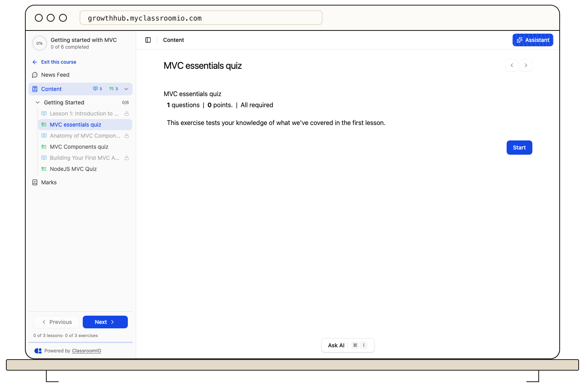
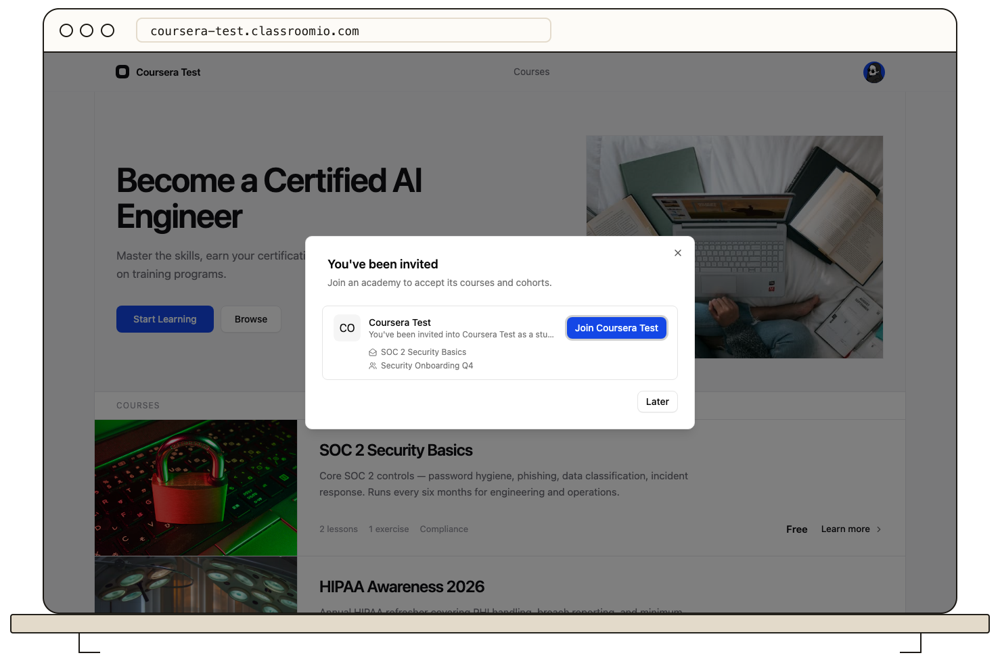

Open the invitation link you received from the academy or course team. Confirm that it names the academy or course you expected before continuing.

1. For an email-specific invitation, sign in or create an account with the invited email address. For a reusable invitation link, use the account you want to join with.
2. Return to the invitation flow after sign-in. Select **Accept invitation** on an emailed invitation, or **Join course** on a reusable course link.
3. Open **Home** or **My Learning** to check for your new course. An academy invitation may give you an account before any course is assigned.

**Already signed in?** If invitations were sent to your verified email address, you don't need the link. When you open ClassroomIO, a dialog titled **You've been invited** lists your invitations grouped by academy, with the courses and cohorts each invitation includes. Select the Join button for an academy to accept everything from that academy at once — you'll see links to your new courses right away, and you can join your other academies from the same dialog without reloading. Select **Later** to decide afterwards. If a message says you joined but the page could not update, reload the page to see your new academy. You can return to your invitations from the bell icon in the top bar, or from **Review invitations** on the **My Learning** page. In-app invitations only work for your verified email address. If your email isn't verified yet, the academy's site shows its invitation with a **Send verification email** button; verify, then join. Reusable invitation links still need the link itself.

A link can expire, reach its use limit, be revoked, or be replaced by a newer invitation. If it no longer works, ask the inviter for a new one. If you signed in with a different email, an emailed invitation shows "You are logged in with a different email from this invite" and the invited address. Sign out and sign in with that address, or ask the academy administrator to check the invitation.

Do not forward an email-specific invitation link to others. For open enrollment, see [Enroll yourself in a course](/learner-guides/enroll-yourself-in-a-course).
