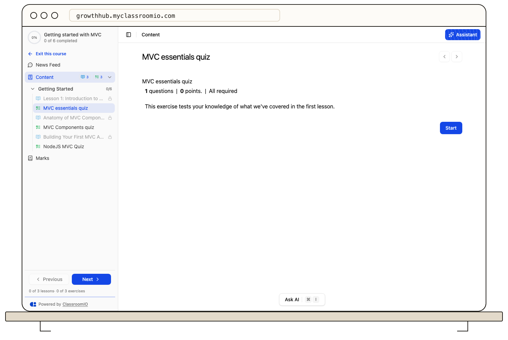

Open the invitation link you received from the academy or course team. Confirm that it names the academy or course you expected before continuing.

1. If you have an account, sign in with the invited email address. Otherwise, create one from the invitation page.
2. Return to the invitation flow after sign-in. For a course invitation, select **Join course** if the enrollment page asks you to confirm.
3. Open **Home** or **My Learning** to check for your new course. An academy invitation may give you an account before any course is assigned.

A link can expire, reach its use limit, or be revoked. If it no longer works, ask the inviter for a new one. If you signed in with a different email, sign out and retry with the invited address or ask the academy administrator to check the invitation.

Do not forward a private invitation link to others. For open enrollment, see [Enroll yourself in a course](/learner-guides/enroll-yourself-in-a-course).
