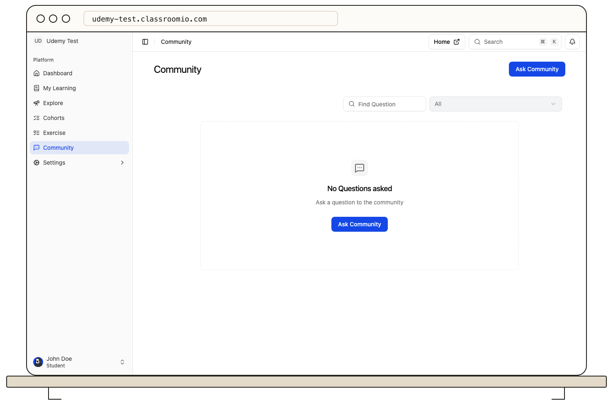

If your academy enables **Community**, open it from the student LMS to read questions and answers.

To respond, open a question, write your answer or comment, and publish it. You can edit a **question you authored** from its question page, including its title, body, and course link. Answers and comments cannot be edited after posting; delete your own response and post a corrected one instead. You can remove your own question or response, and administrators can remove posts for moderation.

Check the course context before posting so other students can find the discussion. Do not include another student's private marks, contact details, or login information in a public post.

For the steps to create a question, see [Ask a Community question](/student-guides/ask-a-question).
