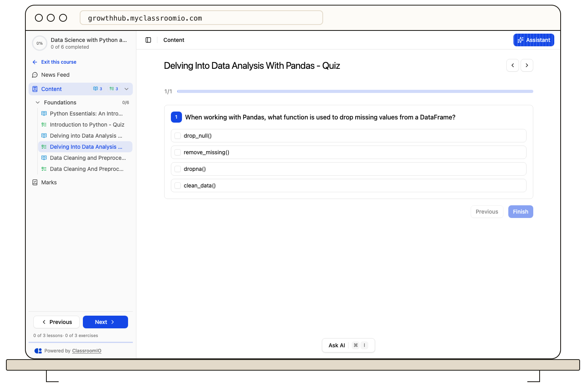

Open the exercise from your course outline. Work through its questions and provide the requested response for each one. Question types can include choices, text, files, or other interactions chosen by the course team.

Review your answers before selecting **Finish**. If the form highlights a missing or invalid response, complete it and try again. ClassroomIO can save an in-progress draft in your browser, but do not rely on that draft across devices or after clearing browser data.

After submission, check the status shown on the exercise. Automatically graded answers can show a result quickly; other answers wait for an instructor. Your submitted attempt is separate from the draft, and the exercise may offer another attempt only if the course settings allow it.

For a pending result, see [View marks and instructor feedback](/learner-guides/view-marks-and-instructor-feedback). If submission fails, stay on the page, check your connection, and retry once rather than assuming it was received.
