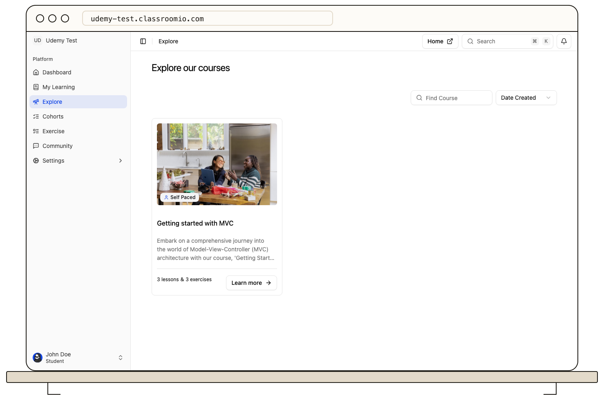

Select **Explore** in the student LMS to browse published courses available for discovery in your academy. Search by title and use the sort or view controls to scan the catalog.

Select a card to preview the course, including its description, lesson and exercise counts, requirements, and displayed price. A free course with self-enrollment open shows **Enroll Now**; a paid one shows **Buy Now**. The button is disabled when the course is not accepting self-enrollment.

Explore is a catalog, not a guarantee that you can join every listed course. Ask the course team for an invitation if enrollment is restricted. Once you join, the course moves to **Home** and **My Learning**.

## Related guides

- [Enroll yourself in a course](/learner-guides/enroll-yourself-in-a-course)
- [Join a paid course](/learner-guides/join-a-paid-course)
