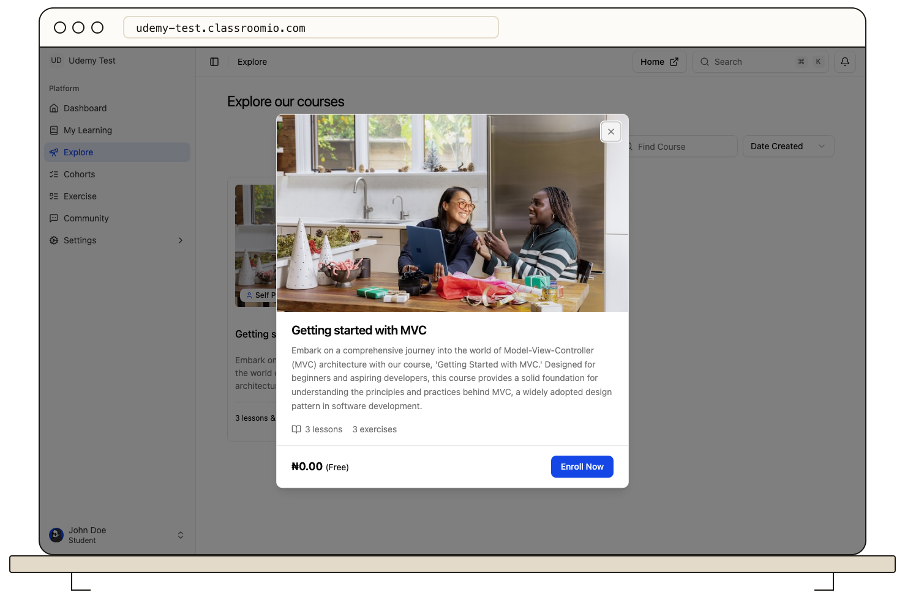

You can join a course yourself when its academy permits self-enrollment.

1. Open the academy's course catalog or **Explore** in the student LMS.
2. Select the course and review its description, requirements, and price.
3. Choose **Enroll Now** for a free course. Sign in or create an account if prompted.
4. On the enrollment page, select **Join course** and wait for confirmation.
5. Find the course on **Home** or **My Learning**.

If the course says it is not accepting enrollment, contact its team for an invitation or direct assignment. A course can appear in **Explore** even when you cannot self-enroll. If a price is shown, use [Join a paid course](/learner-guides/join-a-paid-course) and review payment before confirming.

If the course does not appear after joining, refresh **My Learning** and confirm you signed in to the correct academy account.
