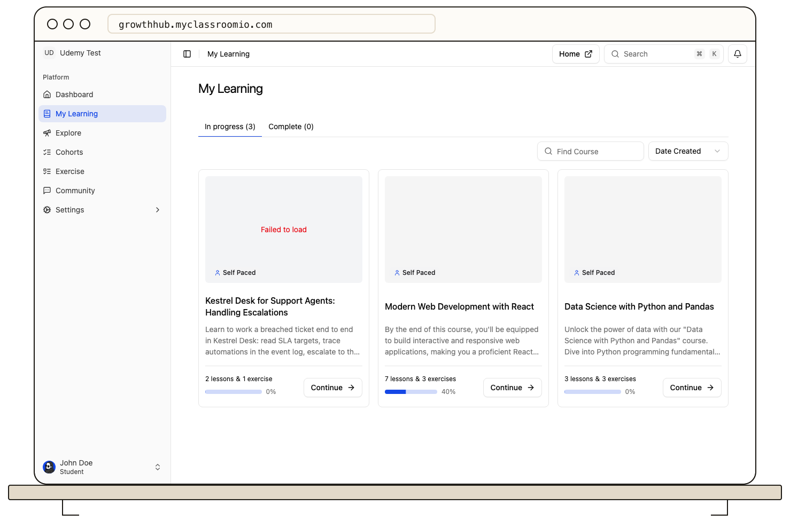

Select **My Learning** in the student LMS to see courses you have joined. The **In progress** and **Complete** tabs separate courses by their completion state; the count on each tab shows how many courses are in that group.

Use search to narrow the visible list, then open a course card to continue. **Home** also shows enrolled courses with progress, while **My Learning** is better when you want to filter a longer list.

If a course is missing, check the other tab and clear your search. Then confirm you are signed in to the correct academy and account. Courses you have not joined belong in **Explore**, not My Learning. If you were invited but have not accepted, return to the invitation link.

## Related guides

- [Discover courses in Explore](/learner-guides/discover-courses-in-explore)
- [Navigate lessons and exercises](/learner-guides/navigate-lessons-and-exercises)
