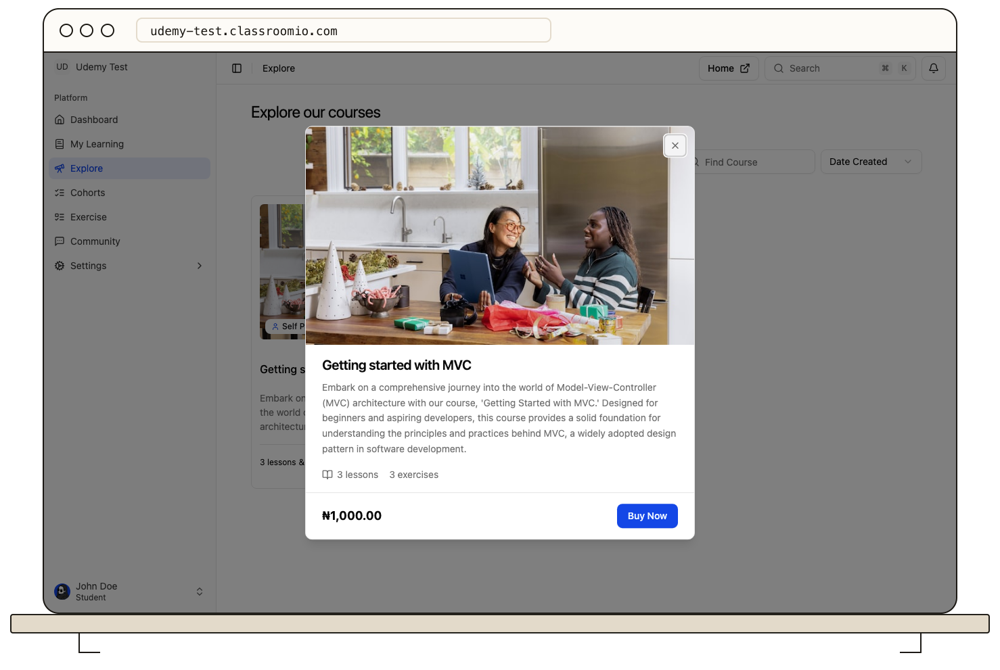

A paid course shows its price on the course preview or landing page. Select **Buy Now** to open the course page and review its full details, currency, and any displayed discount.

1. Confirm the course and academy are the ones you want.
2. Select the purchase action on the course page and follow the checkout instructions shown by the payment provider.
3. Return to ClassroomIO after payment and check **Home** or **My Learning** for the course.

Opening a direct enrollment URL without payment or a valid invitation can show **payment or invite required**. Some academies grant access through an invitation or direct assignment instead of checkout; ask the course team if that applies to you.

If you paid but cannot open the course, keep your payment confirmation and contact the academy. Do not submit payment details or card numbers in a public discussion. See [Find courses in My Learning](/learner-guides/find-courses-in-my-learning) to check access.
