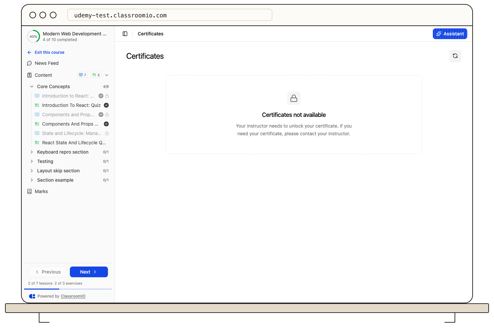

A certificate becomes available after you complete every required lesson and exercise in the course, pass any exercise with a **Passed** completion rule, and finish by the course completion deadline if one is set. Items with a **None** completion rule are optional and do not count. A course with only optional items has no required content to complete, so ask the course team to add required work if no certificate appears.

Open the course and check your progress and any unfinished or locked items. If an exercise with a **Passed** rule is submitted but not graded, wait for its result; eligibility depends on a passing grade. Some compliance courses also run in cycles, so the relevant cycle and deadline matter.

When you qualify, the course's **Certificates** area shows the earned certificate. The academy must have certificate features enabled, and the course team controls whether students may download it.

If you believe you met every rule but no certificate appears, ask the course team to check its completion and certificate settings. See [View and download your certificates](/learner-guides/view-and-download-your-certificates) for the next step.
