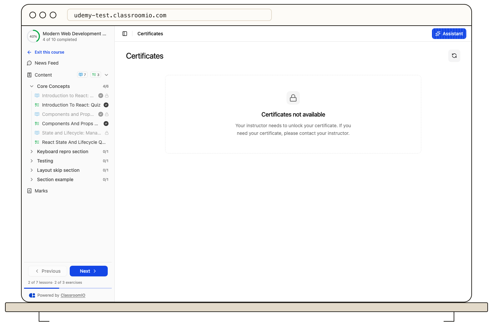

A certificate becomes available only after you meet the course team's requirements. These can include a minimum course completion level, required lessons, a submitted or passed final exercise, and grading that is still pending.

Open the course and check your progress and any unfinished or locked items. If an exercise is submitted but not graded, wait for its result; a passing rule may delay eligibility until grading is complete. Some compliance courses also run in cycles, so the relevant cycle and deadline matter.

When you qualify, the course's **Certificates** area shows the earned certificate. The academy must have certificate features enabled, and the course team controls whether students may download it.

If you believe you met every rule but no certificate appears, ask the course team to check its completion and certificate settings. See [View and download your certificates](/learner-guides/view-and-download-your-certificates) for the next step.
