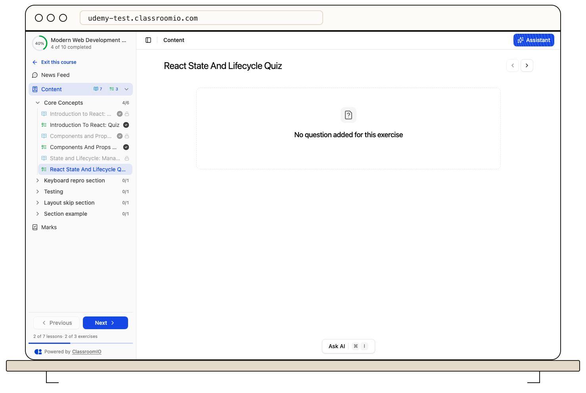

Open a course from **Home** or **My Learning**. Its outline lists lessons and exercises, often grouped into sections. Select an available item to open it; the outline helps you see where you are and what comes next.

Lessons contain teaching material such as text, video, or downloads. Exercises ask for responses and may need submission or grading. Use the course navigation to move to the next available item, or choose another item from the outline. Your course card and outline show progress so you can return later.

A locked item cannot be opened yet. The course team may require earlier content, a passing mark, or another access condition. Read [locked content and progression](/learner-guides/understand-locked-content-and-progression) before assuming something is broken.

If you leave an exercise partway through, reopen it and check that your draft answers are still present before submitting; draft behavior can depend on your browser and the exercise type.
