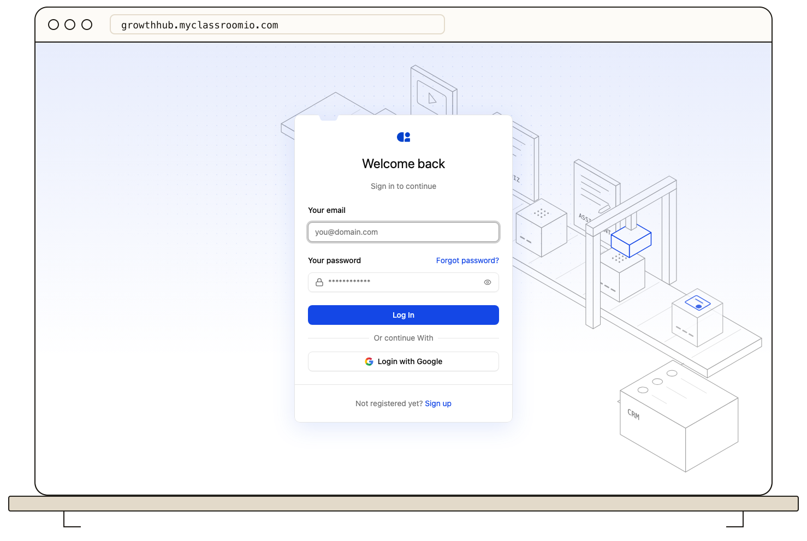

Start at the sign-in page for your academy, using its invitation link, academy address, or verified custom domain. Use the same email address and method you used when joining.

If you registered with an email and password, select **Forgot password?**, enter your email, and follow the reset message. Open the newest reset email; an older or already-used link may fail. Check spam or ask the academy administrator to confirm the address if no message arrives.

If you normally use **Google** or your organization's **SSO** provider, use that sign-in option. A ClassroomIO password reset may not change a password managed by your identity provider. If your academy has disabled email-and-password sign-in, ask its administrator which method is allowed.

Never send your password or a reset link to support or another student. For invitation problems, see [Accept an academy or course invitation](/learner-guides/accept-an-academy-or-course-invitation).

If the sign-in method or a reset email still fails, follow [login and verification email troubleshooting](/troubleshooting-and-reference/troubleshoot-login-and-verification-emails).
