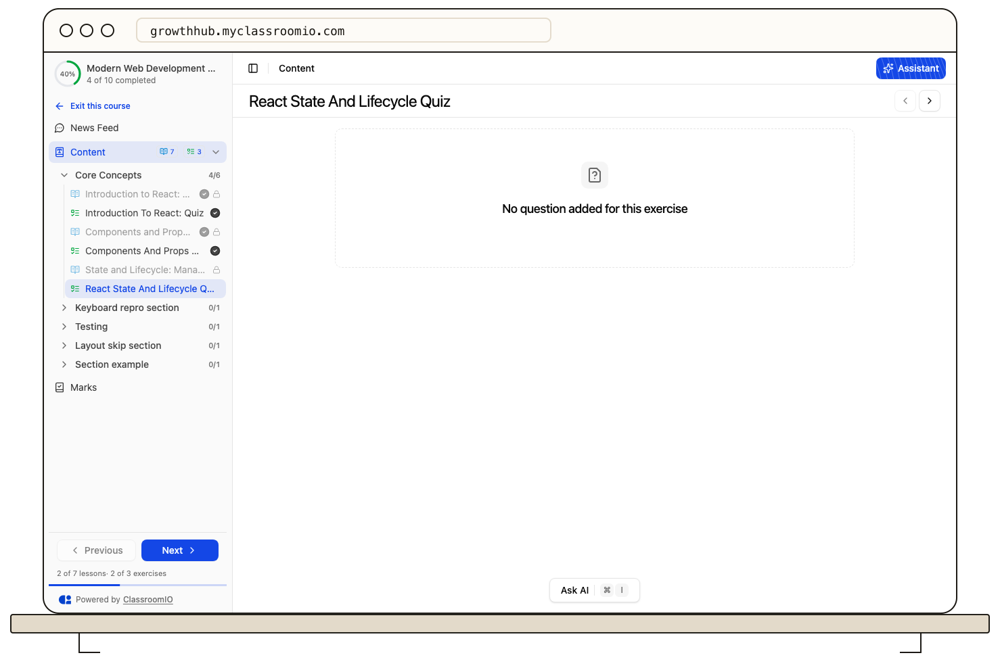

Some courses let you choose any available item. Others use **sequential progression**, so you must complete earlier lessons or exercises before the next one opens. A lock in the course outline marks content you cannot enter yet.

Hover over the lock icon in the outline, or over the **Next** button, to see why it's closed:

- **Complete previous content first** means the course is sequential. If you open the item's page from a link, it names the item to finish; optional items don't count. A lesson may require its completion action; an exercise may require submission or a passing grade. If the exercise is awaiting manual grading, the next item may stay locked until the course team grades it.
- **Not released yet** means the course team hasn't released the item. Finishing other work won't open it, so check back later.

Submit any unfinished exercise, then refresh the course. If you met the displayed requirement but the item is still closed, contact the course team with the course and item names. Do not create a second account to bypass the lock.

See [Navigate lessons and exercises](/learner-guides/navigate-lessons-and-exercises) for the course outline.
