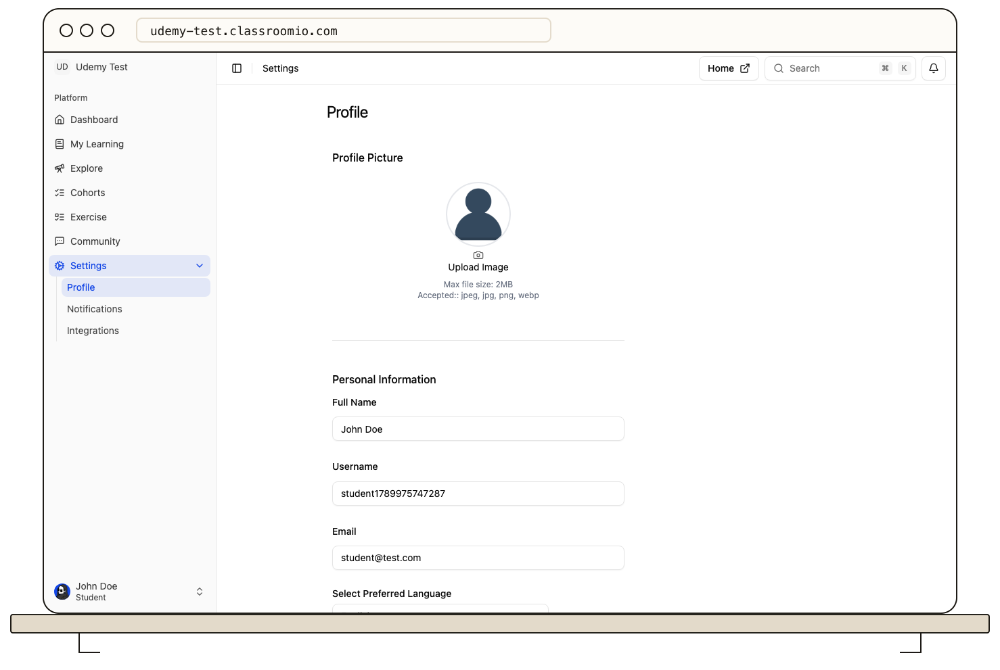

From the student LMS, open **Settings → Profile**. Update your photo, full name, username, and preferred language, then select **Save changes** in the save bar. Use **Discard** to undo unsaved edits.

Changing **Email** starts a separate verification process. Enter the new address, use the email-change action, and open the verification message sent there. If your academy uses SSO, its identity provider may control some account details.

For email choices, open **Settings → Notifications**. Turn optional course or cohort messages on or off, then save. Organization-wide preferences can also affect delivery. Security and other required account emails are not controlled by these switches.

Your updated name and photo can appear on course and Community posts. See [Update your personal profile](/account-team-security/update-your-personal-profile) for the full profile steps.
