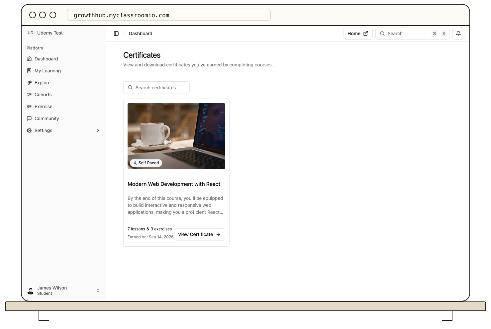

Open **Certificates** in the student LMS to find courses for which you have earned a certificate. Use the search box if you have a long list, then open the relevant course's certificate area to preview it.

If **Download** is available, select it and check your browser's Downloads folder. You can print the downloaded document if needed. Some certificates show an identifier for verification; use the details on the certificate when sharing it.

A missing certificate usually means a completion or grading condition is still unmet. If you can view a certificate but cannot download it, the course team may have disabled student downloads. Ask them to check **Certificates → Settings** for that course. Browser download permissions can also block the file.

See [Know when you qualify for a certificate](/learner-guides/know-when-you-qualify-for-a-certificate) and [Help a student download a certificate](/deliver-and-engage/help-a-learner-download-a-certificate) for eligibility checks.
