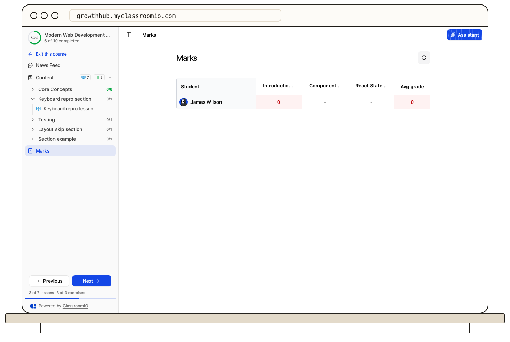

Open **Exercise** in the student LMS, if your academy shows that navigation item, to browse exercises by status: not submitted, in progress, submitted, or graded. You can also open an exercise from its course outline.

A **Submitted** status means your attempt was received but may still need marking. A **Graded** status lets you review your score, per-question results where available, and instructor feedback. A passing threshold can determine whether the exercise counts as complete, so a graded result does not always unlock the next item.

If your result is pending, wait for the course team to finish grading. If a score or comment seems incorrect, contact the instructor with the exercise name and attempt; do not post private feedback publicly. If another attempt is available, review the feedback before resubmitting.

See [Complete and submit an exercise](/learner-guides/complete-and-submit-an-exercise) for the submission flow.
