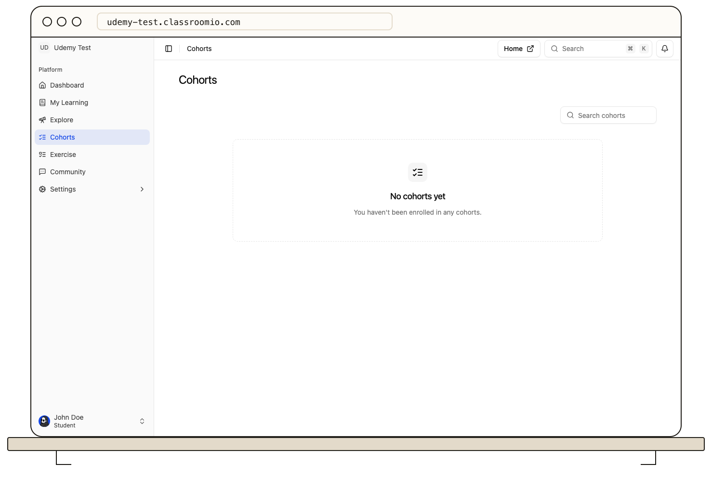

Select **Cohorts** in the student LMS to see the groups you belong to. Open a cohort to review its linked courses, news feed, and goals, if its administrators have configured them.

A cohort groups students and courses around a shared plan. Its goal can depend on progress across several courses; completing a single lesson does not necessarily finish the cohort goal. Open each linked course to check what remains, and use **My Learning** for your personal list of enrolled courses.

If the expected cohort is missing, confirm you signed in to the correct academy account. Ask an administrator to check your cohort membership. If a goal looks wrong after you finish coursework, refresh the page and compare the course completion rules before contacting the team.

For an overview of how cohorts relate to courses, see [Cohorts](/reference/cohorts).
