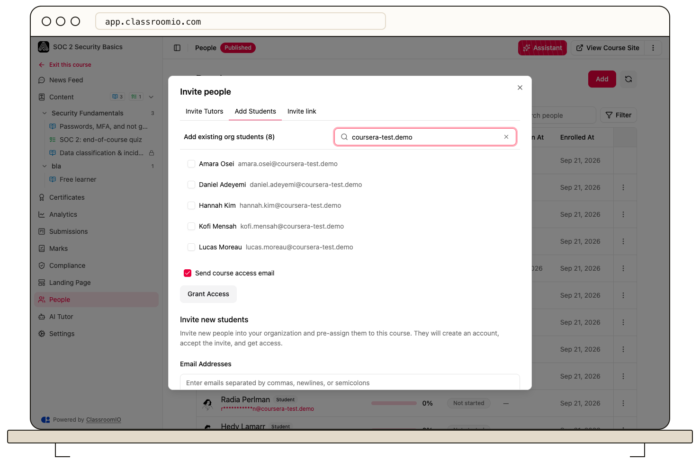

Organization administrators can select an existing student under **People → Add → Add Students** and use **Grant Access** to enroll them immediately.

## Before you start

The person must already be a student in your organization. Tutors do not see the organization-wide student picker; they can [invite students by email](/manage-students/invite-students).

For a paid course, verify payment first. Direct assignment grants access without charging the student. Publish the course before expecting students to open its content.

## Grant access

### 1. Find the existing student

Open the course and select **People → Add → Add Students**. Under **Add existing org students**, search for the person's name or email.

### 2. Choose students and notification

Select the student or students you want to add. **Send course access email** is on by default; clear it if you do not want ClassroomIO to send that notification.

### 3. Enroll them

Select **Grant Access**. Existing organization students receive enrollment directly and do not need to accept another invitation. Check **People** to confirm their course membership.

## If the student is missing

Students already enrolled in this course are excluded from the picker. Check the course roster first. If the person is not in your organization's audience, use **Invite new students** instead.

For students who need several courses, [assign access in bulk from Audience](/manage-learners/assign-learners-to-courses-in-bulk). To grant access across a course collection, [assign a cohort](/manage-learners/assign-learners-to-a-cohort).

## Related guides

- [Choose how students join a course](/manage-students/course-enrollment)
- [Review a student's course progress](/manage-learners/review-a-learners-course-progress)
