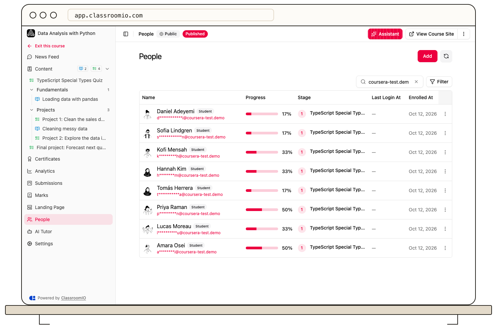

Use a course’s **People** page to invite students or tutors, review the roster, and remove someone’s access to that course.

## Open the roster

Administrators and tutors with course access open the course and select **People**. Search by name or email and use the people views or **Filter** to narrow the roster.

The list distinguishes students, tutors, and pending people. Progress and learning stage apply to students; a dash on a tutor row does not mean zero student progress.

## Add a student

Select **Add → Add Students**. Organization administrators can [grant access to existing organization students](/manage-learners/add-a-learner-directly-to-a-course). Administrators and course tutors can [invite new students by email](/manage-students/invite-students) or [share an invite link](/manage-learners/invite-learners-with-a-reusable-link).

Verify payment before granting paid-course access, and publish the course before students need to study it.

## Add a tutor

Organization administrators select **Add → Invite Tutors**, choose tutors from the organization, and select **Finish**. If the intended tutor is not available, add them to the organization's team from **Settings → Teams** first.

Tutor access is teaching access. Do not use it as a substitute for enrolling a student.

## Remove someone from the course

:::warning[Removal changes course access]
Deleting a student from the roster permanently removes their course membership and course learning records, including lesson completion, submissions, video progress, attendance, comments, and completion records. It does not delete their global account or memberships in other courses. Export any records you need before continuing.
:::

Find the person, open the row's action menu, choose **Delete profile**, and check the email in the **Delete** confirmation before selecting **Yes**. You cannot remove yourself through your own row action.

If the student belongs to a cohort that grants this course, review that cohort as well. Reassigning a cohort can grant its course access again.

For organization-wide access changes or seat cleanup, use [archive or deactivate in Audience](/manage-students/find-and-remove-inactive-students).

## Related guides

- [Review a student's course progress](/manage-learners/review-a-learners-course-progress)
- [Assign students to a cohort](/manage-learners/assign-learners-to-a-cohort)
