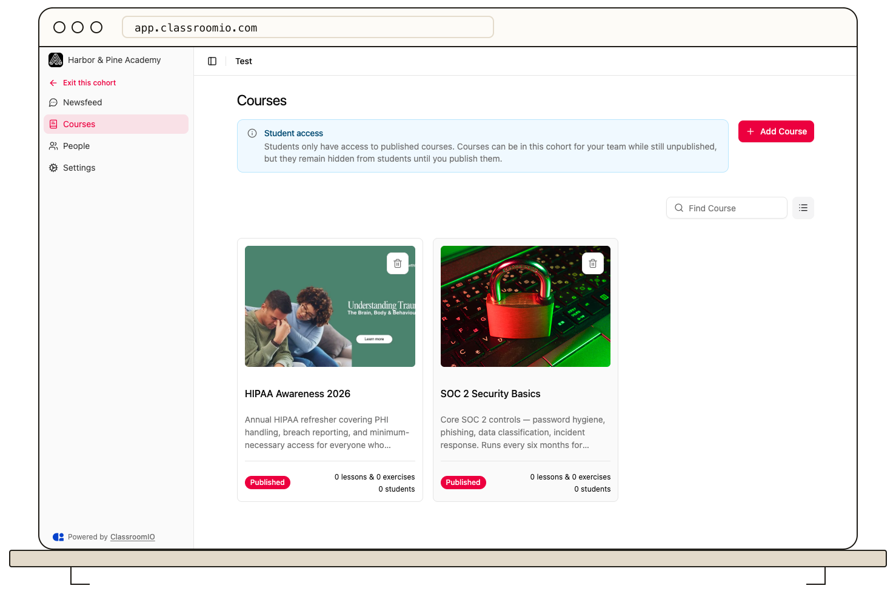

Open the cohort’s **Courses** page and select **Add Course** to link existing courses. Current cohort students receive access to the added courses, and new cohort students receive access when assigned.

## Before you add courses

You need organization administrator access or an appropriate administrator or tutor role in the cohort. Create the courses first; this picker links existing courses rather than creating new ones.

:::warning[Linked courses grant access]
Review the cohort's members before linking a course. Adding a paid course can give those students access without collecting payment.
:::

## Link courses

### 1. Open the course picker

Open **Cohorts**, select the cohort, and open **Courses → Add Course**.

### 2. Select the courses

Search the list and select one or more courses. Courses already linked to this cohort are excluded from the available choices. If no courses are available, create the intended course or check whether it is already linked.

### 3. Add and check access

Confirm with **Add Course**. The linked courses appear in the cohort's list. Existing cohort students are enrolled in those courses; future cohort assignments include them as well.

Students only have access to published courses. An unpublished course can stay in the cohort while your team prepares it, but remains hidden from students until you [publish it](/build-courses/publish-a-course-and-allow-self-enrollment).

## Remove a linked course

Use the course's remove control in the cohort list and confirm the intended course. This removes the cohort link, not the course itself. Existing course memberships are not automatically removed; use [the course roster](/manage-learners/add-and-remove-people-from-a-course) if you need to revoke a student's access.

If a course is referenced by a learning goal, review that goal when changing the course collection.

## Related guides

- [Assign students to a cohort](/manage-learners/assign-learners-to-a-cohort)
- [Configure cohort goals and settings](/manage-learners/configure-cohort-goals-and-settings)
