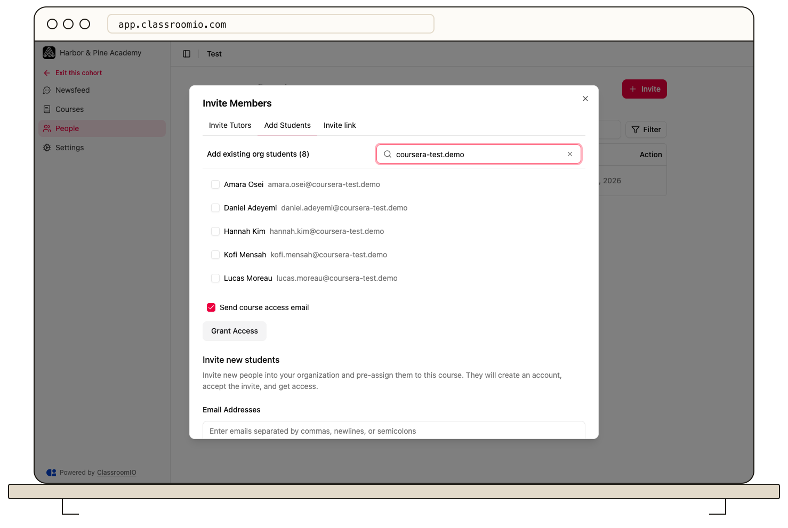

Use a cohort’s **People → Invite** dialog to add existing students, invite new students by email, or share an invite link. Cohort assignment also grants access to its linked courses.

## Before assigning members

Organization administrators and the cohort's administrators or tutors can manage student invitations. Only organization administrators can browse the existing organization student picker and team tutor picker.

Review the cohort's **Courses** first. Assigning a student grants access to those courses, including paid courses without collecting payment. Students only see courses once they are published.

## Add existing organization students

As an organization administrator, open the cohort and select **People → Invite → Add Students**. Search **Add existing org students**, select the people to add, review the email notification checkbox, and select **Grant Access**.

Existing students receive membership directly. They do not need to accept a new invitation. Check the cohort **People** list and linked course rosters to confirm access.

## Invite new students

In **Add Students**, find **Invite new students** and enter email addresses in **Email Addresses**. Choose whether to send invitation emails, then select **Invite Students**.

New people accept the invitation and create an account if needed. Check [student seats and signup policies](/manage-students/enrollment-access-control) if they cannot join. Organization administrators can use [CSV import](/manage-learners/import-learners-from-a-csv-file) with **Cohort Access** for a larger list.

## Share one link

Select **Invite link → Create invite link**, then **Copy invite link**. Anyone receiving the active link can join this cohort and its linked courses. [Disable the link](/manage-learners/invite-learners-with-a-reusable-link) when you no longer want it used.

## Add tutors or remove members

Organization administrators can use **Invite Tutors** to select tutors from the organization and finish the assignment. For removal, find the person in cohort **People**, open their action menu, and review the confirmation carefully.

Removing cohort membership does not automatically remove their existing course memberships. Review [course access](/manage-learners/add-and-remove-people-from-a-course) separately when a student should leave both the group and its courses.

## Related guides

- [Understand cohorts](/reference/cohorts)
- [Configure cohort goals and settings](/manage-learners/configure-cohort-goals-and-settings)
- [Track a cohort with analytics](/analytics-and-reporting/track-a-cohort-with-analytics)
