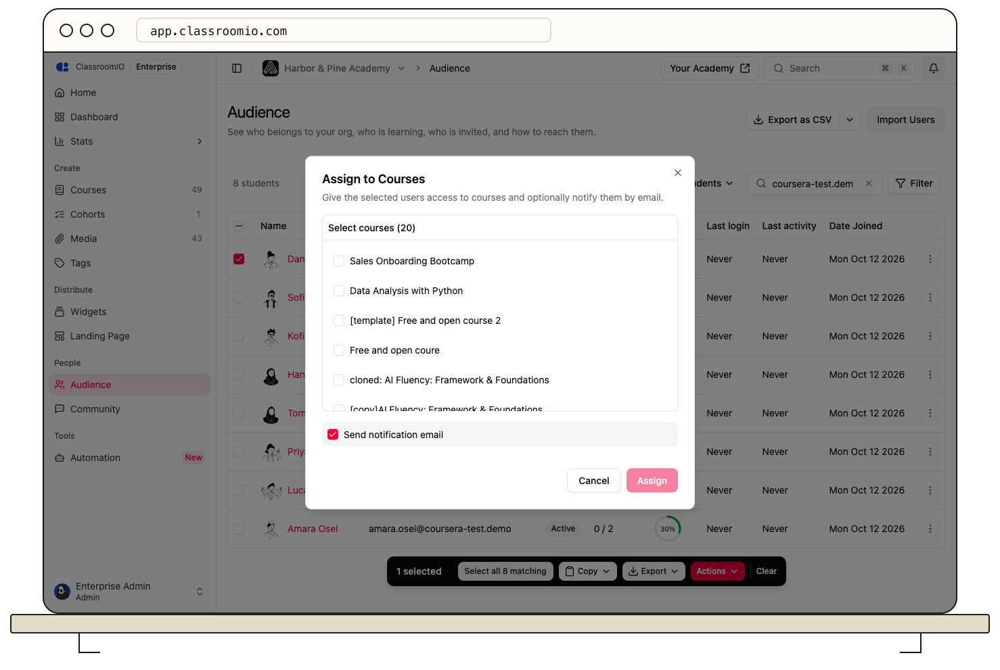

In **Audience**, select existing students and use **Actions → Assign to Courses** to enroll them in several courses at once.

## Before assigning access

You must be an organization administrator. Select students who already have accounts in the audience. Use [CSV import](/manage-learners/import-learners-from-a-csv-file) for new people or pending invitations.

:::warning[Assignments grant access immediately]
Verify payment before assigning a paid course. Assignment does not collect payment or require the existing student to accept another invitation.
:::

## Assign courses

### 1. Select students

Open **Audience**, search or filter the list, and select individual student checkboxes. Use the header checkbox for the current page if appropriate.

**Assign to Courses** requires a specific row selection. It is unavailable when you have selected all matching students across the filtered result set. Narrow the list or select the rows you need instead.

### 2. Choose courses

Open **Actions → Assign to Courses**. Search the course list and select each course you want to assign. Check the selected-student count and course names.

### 3. Choose notification and assign

Leave **Send notification email** selected to notify students, or clear it before continuing. Select **Assign**.

ClassroomIO gives the selected existing students access and skips course memberships they already have. Review the result, then check the course's **People** page. The course must be published for students to open its content.

## Assign a collection of courses

For a group that should share the same courses and learning goals, [assign students to a cohort](/manage-learners/assign-learners-to-a-cohort) instead. Cohort assignment grants access to its linked courses.

## Related guides

- [Add one student directly to a course](/manage-learners/add-a-learner-directly-to-a-course)
- [Review a student's course progress](/manage-learners/review-a-learners-course-progress)
