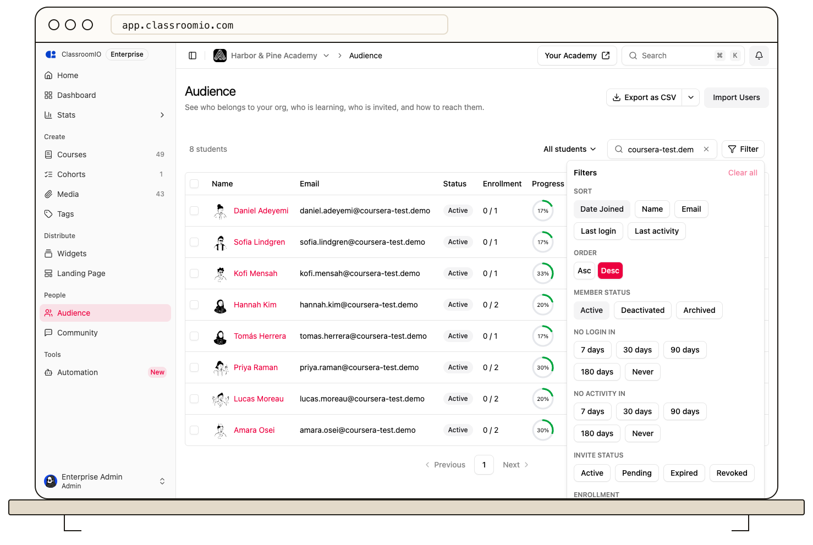

Open **Audience** to search your organization’s students and combine filters for enrollment, completion, activity, invitations, and membership state.

## Open and search Audience

Organization administrators can open **Audience** from the organization sidebar. Search by name or email to narrow the list. Select a student's name to [open their profile](/manage-learners/view-a-learner-profile-and-activity).

The table shows invitation or membership status, completed/enrolled course counts, progress, last login, last activity, and date joined. An enrolled student can still have no learning activity.

## Use a saved view

Open **All students** above the table and choose a view such as **Never logged in**, **Inactive 90+ days**, **Inactive 180+ days**, **Enrolled, never started**, or **Archived**. These views apply a useful combination of filters; review the visible filter state before taking an action.

## Combine filters

Select **Filter** and choose the conditions you need:

- **Member status:** Active, Deactivated, or Archived.
- **No login in** and **No activity in:** 7, 30, 90, or 180 days, or Never.
- **Invite status:** Active, Pending, Expired, or Revoked.
- **Enrollment:** Enrolled or Not enrolled.
- **Completion:** Not started, In progress, or Completed.
- **Certificate:** Earned or Not earned.

Filters combine, so a student must match the selected conditions. With time-based inactivity filters, review **Exclude recent joiners** before deciding someone has been inactive long enough. It is on by default.

Use the sort controls to order by name, email, join date, last login, or last activity. Use **Clear all** to remove filters, and clear search separately if needed. You can bookmark the filtered page URL to return to the same view.

## Act on the results

[Export the filtered audience](/manage-learners/export-your-audience), [assign selected students to courses](/manage-learners/assign-learners-to-courses-in-bulk), or [review inactive students](/manage-students/find-and-remove-inactive-students). Check the selection count before any bulk change.
