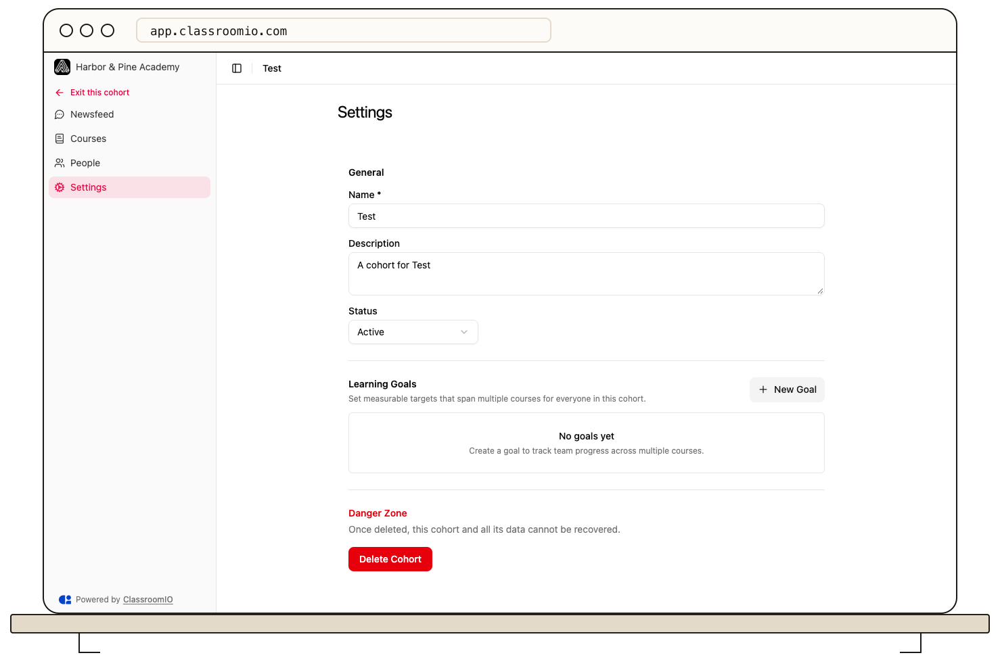
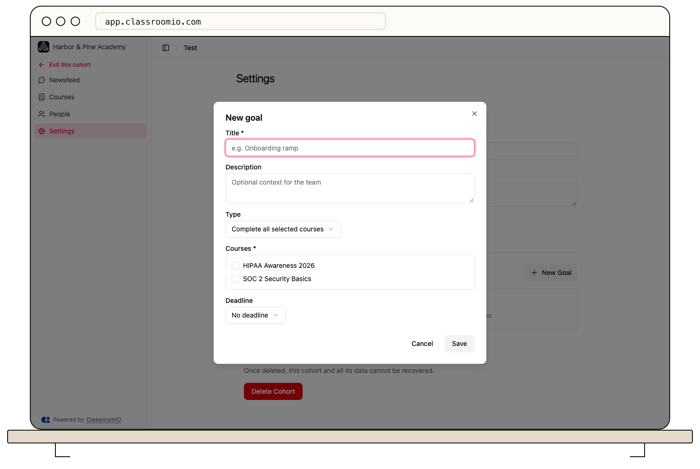

Open a cohort’s **Settings** to update its details and create **Learning Goals** across selected courses. Choose the goal type, deadline, and reminders to match your training requirement.

## Update cohort details

Organization administrators and the cohort's assigned administrators or tutors can manage its teaching settings. Open the cohort and select **Settings**.

Under **General**, edit **Name**, **Description**, or **Status**. The available statuses are **Active**, **Inactive**, and **Archived**. Select **Save changes** in the save bar, or **Discard** to abandon the edits. Set the cohort to Active when you want its reusable invitation to accept new members.

## Create a learning goal

### 1. Name the target

Under **Learning Goals**, select **New Goal**. Enter a **Title**, optionally add a **Description**, and select at least one of the cohort's **Courses**.

### 2. Choose how success is measured

Select **Type**:

- **Complete all selected courses:** requires every selected course.
- **Complete N of M selected courses:** set **Number of courses required**.
- **Score above threshold on every course:** set **Per-student pass score (%)**.
- **Team pass-rate threshold:** set the per-student score and **Team pass rate (%)**.
- **Readiness (no deadline):** tracks readiness without a due date.

A goal measures learning across courses. Continue to configure each course's own [progression and completion requirements](/create-and-deliver/course-progression) separately.

### 3. Set timing and reminders

Choose **No deadline**, **Absolute date**, **Relative to student joining**, or **Recurring**. Depending on the choice, enter a date, days from joining, or a repeat interval in months. Readiness goals use no deadline.

For a goal with a deadline, enter **Reminders (days before due)** as comma-separated days, such as `7, 3, 1`. Review the target courses, thresholds, and timing, then select **Save**.

## Maintain or delete goals

Use the goal's edit action to change its settings. Before deleting a goal, note that its per-student status history is removed. Review the confirmation before proceeding.

To see who is overdue against a goal and send reminders, open the cohort's **Analytics** and use its **Overdue** card. See [Track a cohort with analytics](/analytics-and-reporting/track-a-cohort-with-analytics).

## Delete a cohort

:::danger[Deletion cannot be undone]
**Delete Cohort** removes the cohort and its group data, including its goals and news feed. It does not delete the underlying courses or automatically revoke existing course enrollment.
:::

Use **Danger Zone → Delete Cohort** only after checking the cohort and retaining any records you need. Confirm the permanent deletion when prompted.

## Related guides

- [Add courses to a cohort](/manage-learners/add-courses-to-a-cohort)
- [Assign students to a cohort](/manage-learners/assign-learners-to-a-cohort)
- [Track a cohort with analytics](/analytics-and-reporting/track-a-cohort-with-analytics)
