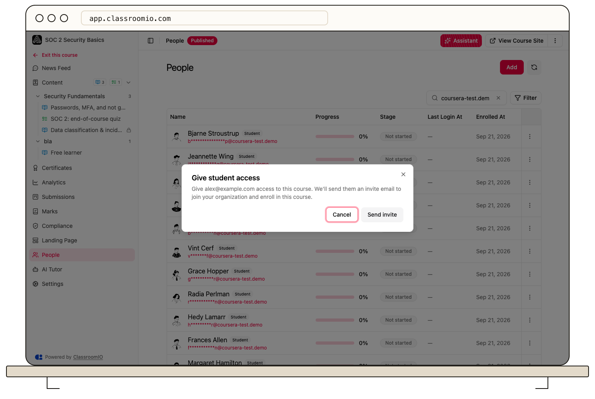

Paid course enrollment uses your payment link and a manual access step. After verifying payment, invite the student or give an existing organization student direct course access.

## Before accepting payments

Set the course price and payment link in the [course landing page](/publish-and-brand/course-landingpage), and publish the course. Confirm that the payment page works and that the course's teaching team can receive payment-request emails.

:::warning[Verify payment before granting access]
Opening a payment page or receiving an enrollment request is not proof of payment. Invitations, direct assignments, and shared invite links can grant paid-course access without collecting money.
:::

## Review a purchase and enroll the student

### 1. Receive the payment request

On the course landing page, the student enters their name and email in **Process course payment** and selects **Next**. ClassroomIO sends payment instructions to the student and a request email to the course's teaching contact.

The student selects **Go to payment**, completes payment with your payment provider, and sends proof of payment to the course administrator.

### 2. Verify the transaction

Check the payment in your provider's records. Confirm the course, amount, and student's email before granting access. ClassroomIO does not automatically confirm this external payment or enroll the student when they open the link.

### 3. Grant course access

Use the access link in the request email to open **Give student access**. Confirm the displayed email and select **Send invite**.

You can also open course **People → Add → Add Students** and [invite the student by email](/manage-students/invite-students). An organization administrator can [grant direct access](/manage-learners/add-a-learner-directly-to-a-course) if the student is already in the audience.

### 4. Confirm the student can study

Ask the student to accept the invitation using the same email address. Check their record under **People**, and confirm the course is published and the intended lessons are unlocked.

## If access is still missing

Check [pending invitations](/manage-learners/manage-pending-invitations), available student seats, and [signup restrictions](/manage-students/enrollment-access-control). A payment receipt alone does not bypass these requirements.
