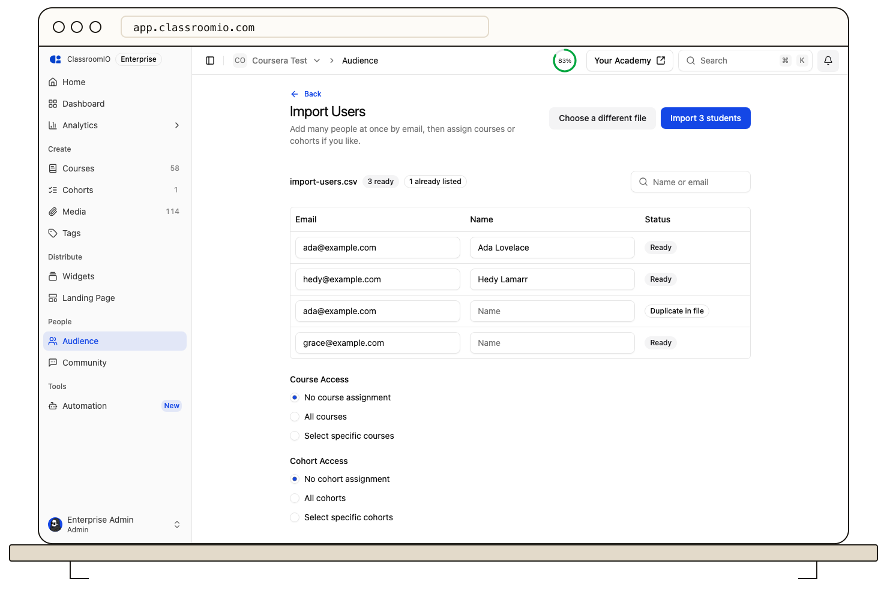

Open **Audience → Import Users**, upload a CSV, and review each row before importing. You can assign courses or cohorts before importing.



## Prepare the file

Organization administrators can import up to 1,000 rows per file. Use a UTF-8 `.csv` file no larger than 5 MB, with an `email` column and an optional `name` column. Download the template from the import page if needed.

```csv
email,name
alex@example.com,Alex Morgan
jamie@example.com,Jamie Chen
```

Split larger lists into multiple files. Student seat limits still apply; **Import Users** can be unavailable when the organization has reached its limit.

## Import the students

### 1. Upload and review

Open **Audience → Import Users**. Drop the CSV into the upload area or select it from your computer. Alternatively, paste addresses into **Email Addresses** and select **Review**.

Read the preview. Each row is marked **Ready**, **Invalid email**, **Duplicate in file**, or **No email**. Checks that need your organization's data (**Already in audience**, **Staff, not a student**, **No seats left**) run when you import and appear in the result.

Fix a row without leaving the page: edit its **Email** or **Name** directly in the preview table. The status and the counts above the table update as you type. A blank address shows **No email**, a malformed one **Invalid email**, and an address that repeats an earlier row (ignoring case and spaces) **Duplicate in file**. Rows with a blank or malformed address keep the name from your file, so correcting the address does not lose it. Names are limited to 200 characters. The name is saved with the invitation and becomes the person's profile name when they accept it, unless they have already set a name other than the one ClassroomIO fills in from their email address. A name they chose is never overwritten. If the same address appears on more than one row, the name on the first row is used and names on **Duplicate in file** rows are ignored. The saved name stays with the invitation if you resend it or change the pending member's email. If you import the same pending address again, the saved name is kept when the row's name is blank or missing, even if the earlier invitation was revoked or expired, and a name you supply in the new import replaces it. The name is applied however the person accepts the invitation. Only rows marked **Ready** are imported. The preview shows 20 rows per page; use the page controls below the table to move through a longer list, and the search box above the table to find a person by name or email. The search is not case-sensitive and checks every row, not only the current page, and the page controls appear only when more than 20 rows are showing. The counts above the table and the **Import** button always cover every Ready row, including rows on other pages or hidden by a search. To start over with a different list, use **Choose a different file**. Check warnings about ignored columns or rows beyond the limit.

### 2. Choose access

Under **Course Access**, choose no assignment, all courses, or specific courses. Set **Cohort Access** separately if needed. Assigning a cohort also grants access to the courses linked to it.

:::warning[Review the access you are granting]
Course and cohort assignments can grant access to paid courses without collecting payment. Confirm the selected courses before importing.
:::

The CSV import page sends invitation emails during the import and currently has no email toggle. Check the recipients before selecting **Import … students**. If you need to create course invitations without sending emails immediately, use [the course invitation dialog](/manage-students/invite-students), which has a notification checkbox.

### 3. Import and check the result

Select **Import … students**, using the count shown on the button. Review the result for new invitations, existing-student assignments, renewed pending invitations, and email failures.

If rows fail, select **Download the rows that failed**, correct them, and retry that smaller list. Do not assume every uploaded row was imported.

## Confirm access

New students accept their invitation and create an account if needed. Existing organization students can receive access directly. Check [pending invitations](/manage-learners/manage-pending-invitations) and the relevant course or cohort **People** page.

## Related guides

- [Assign existing students to courses in bulk](/manage-learners/assign-learners-to-courses-in-bulk)
- [Control enrollment access](/manage-students/enrollment-access-control)
