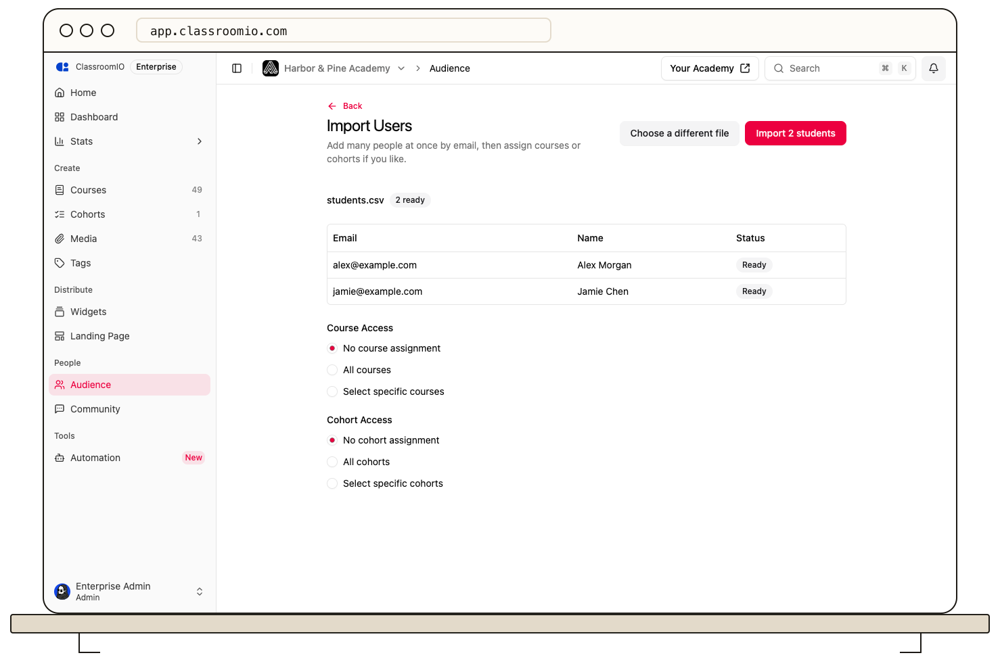

Open **Audience → Import Users**, upload a CSV, and review each row before importing. You can assign courses or cohorts before importing.



## Prepare the file

Organization administrators can import up to 1,000 rows per file. Use a UTF-8 `.csv` file no larger than 5 MB, with an `email` column and an optional `name` column. Download the template from the import page if needed.

```csv
email,name
alex@example.com,Alex Morgan
jamie@example.com,Jamie Chen
```

Split larger lists into multiple files. Student seat limits still apply; **Import Users** can be unavailable when the organization has reached its limit.

## Import the students

### 1. Upload and review

Open **Audience → Import Users**. Drop the CSV into the upload area or select it from your computer. Alternatively, paste addresses into **Email Addresses** and select **Review**.

Read the preview. Rows can be **Ready**, **Already in audience**, **Invalid email**, **Duplicate in file**, **Staff, not a student**, **No seats left**, or **No email**. Correct invalid rows in your source file and use **Choose a different file** to upload again. Check warnings about ignored columns or rows beyond the limit.

### 2. Choose access

Under **Course Access**, choose no assignment, all courses, or specific courses. Set **Cohort Access** separately if needed. Assigning a cohort also grants access to the courses linked to it.

:::warning[Review the access you are granting]
Course and cohort assignments can grant access to paid courses without collecting payment. Confirm the selected courses before importing.
:::

The CSV import page sends invitation emails during the import and currently has no email toggle. Check the recipients before selecting **Import … students**. If you need to create course invitations without sending emails immediately, use [the course invitation dialog](/manage-students/invite-students), which has a notification checkbox.

### 3. Import and check the result

Select **Import … students**, using the count shown on the button. Review the result for new invitations, existing-student assignments, renewed pending invitations, and email failures.

If rows fail, select **Download the rows that failed**, correct them, and retry that smaller list. Do not assume every uploaded row was imported.

## Confirm access

New students accept their invitation and create an account if needed. Existing organization students can receive access directly. Check [pending invitations](/manage-learners/manage-pending-invitations) and the relevant course or cohort **People** page.

## Related guides

- [Assign existing students to courses in bulk](/manage-learners/assign-learners-to-courses-in-bulk)
- [Control enrollment access](/manage-students/enrollment-access-control)
