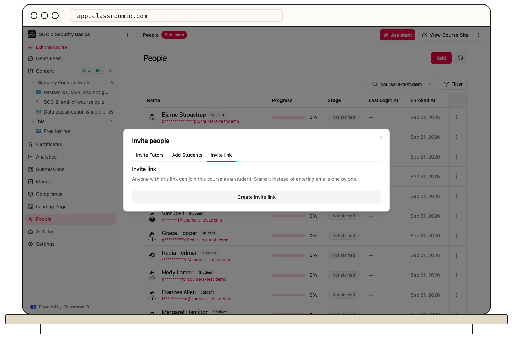

Use **Invite link** in a course or cohort invitation dialog to create one link that multiple students can use. Joining a cohort through this link also grants access to its courses.

## Before sharing

Administrators and tutors with access to the course or cohort can manage its invite link. Anyone who receives the active link can join as a student, including people it is forwarded to. Use [email invitations](/manage-students/invite-students) when you need to invite named recipients instead.

:::warning[The link grants access]
A shared invitation can grant access to paid courses without collecting payment. For a cohort, review every linked course before distributing its invitation.
:::

## Create and share a link

### 1. Open Invite link

Open the course or cohort, select **People → Add** for a course or **People → Invite** for a cohort, then **Invite link**.

### 2. Create the invitation

Select **Create invite link** if a link has not been created. If one already exists, the dialog shows the current link.

### 3. Copy and distribute it

Select **Copy invite link** and share it with your intended students. Keep **Link is active** on.

Students open the invitation, sign in or create an account, and select **Join course** or **Join cohort**. New account creation still follows [organization signup policies](/manage-students/enrollment-access-control), and available student seats are required. Course content remains hidden from students until published.

## Disable or reuse the link

Return to the same dialog and turn off **Link is active**. Nobody can join through that link while it is disabled. Turn it back on to reuse it.

Disabling the link does not remove people who already joined. [Remove course access](/manage-learners/add-and-remove-people-from-a-course) separately if needed. The dialog also shows how many people have joined with the link.

## Related guides

- [Assign students to a cohort](/manage-learners/assign-learners-to-a-cohort)
- [Let students enroll themselves](/manage-learners/let-learners-enroll-themselves)
