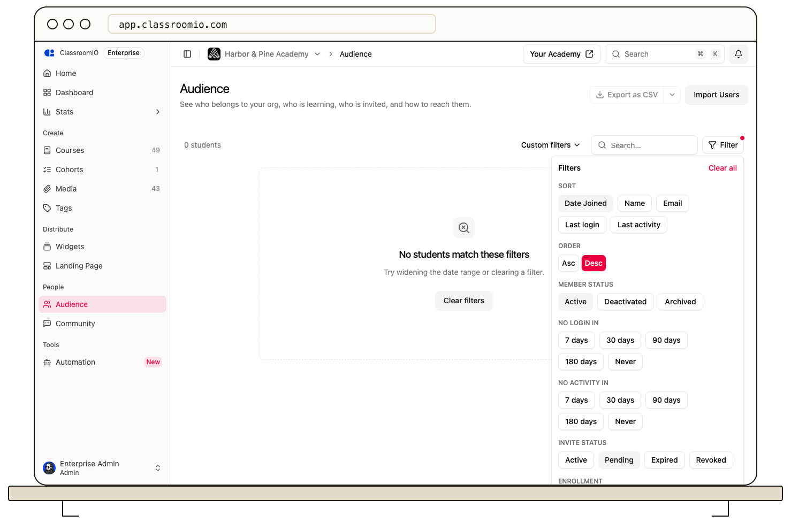

Organization administrators can filter **Audience** by invitation status, then use a row’s **Open actions** menu to resend or revoke an invitation.

## Find an invitation

Open **Audience** and search for the student's email. Select **Filter** and choose **Pending**, **Expired**, or **Revoked** under **Invite status**.

A pending invitation means the person has not completed the join flow. Existing student accounts appear as active members rather than pending invitation records.

## Resend an invitation

Open the invitation row's **Open actions** menu and select **Resend invite**. Resending is available for pending, expired, and revoked invitations. It sends another invitation email and renews access through the invitation flow.

Before resending, confirm the email address, available seats, and intended course or cohort assignments. If the address is wrong, stop using that invitation and [invite the correct address](/manage-students/invite-students).

## Revoke an invitation

:::warning[Revoking stops the invitation]
Revoke only when the recipient should no longer join using that invitation. Revoking a pending invitation is separate from removing an existing student's course access.
:::

For a pending invitation, open **Open actions → Revoke pending invite** and confirm if prompted. The record moves to revoked status. If you later want to invite that person again, use **Resend invite**.

To stop a shared course or cohort link, [turn off Link is active](/manage-learners/invite-learners-with-a-reusable-link) in its own dialog instead.

## If the student still cannot join

Ask them to use the latest email and the same address that was invited. Check spam folders, [organization signup policies](/manage-students/enrollment-access-control), and available seats. **Block all new signups** prevents a new account even with an invitation.

After acceptance, confirm the student's membership and [review their course progress](/manage-learners/review-a-learners-course-progress).

If the email itself is missing, follow [invitation and notification email troubleshooting](/troubleshooting-and-reference/troubleshoot-invitation-and-notification-emails).
