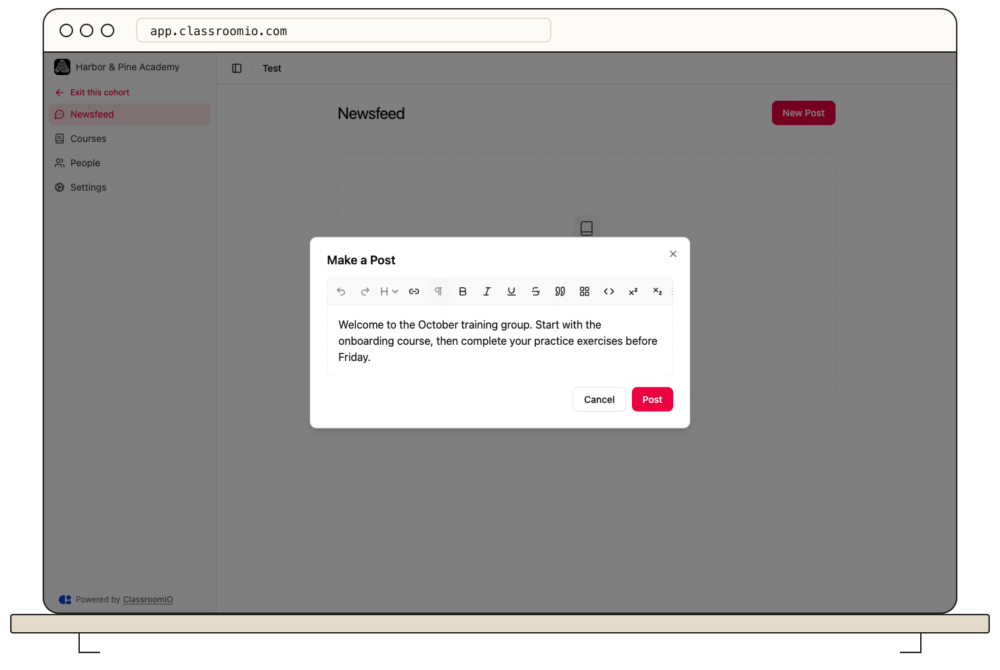

Open a cohort’s **Newsfeed** and select **New Post** to publish an update for the group. Use a pinned post for information members need to find first.

## Before posting

Organization administrators and the cohort's assigned administrators or tutors can create and manage posts. Students can read the group's feed and participate through the available comments and reactions.

Check that you are in the intended cohort before publishing. The post belongs to that group, so write it for the people who have access to the cohort.

## Publish an update

### 1. Open the editor

Open **Cohorts**, select the cohort, and open **Newsfeed**. Select **New Post** to open **Make a Post**.

### 2. Write the message

Enter the update in the editor. For an assignment or deadline, name the course, explain the required action, and include the date. Use the formatting controls where they help readers scan the post.

### 3. Publish and check

Select **Post**. Confirm that the update appears in the cohort feed. Select **Cancel** instead if you want to close the editor without publishing.

Do not assume that publishing a feed post sends a separate email announcement. Use the feed as the shared in-app record.

## Pin or edit a post

Open the post's action menu and select **Pin** to keep it ahead of unpinned updates. Select **Unpin** when it no longer needs that position.

To revise an update, select **Edit**, change the content in **Edit Post**, then select **Post** to save it. Review the visible result after saving.

## Delete a post

:::warning[Review the post before deleting]
Deleting removes the update from the cohort feed. Edit the post when a correction is enough.
:::

Open the post's action menu, select **Delete**, and confirm **Delete** in the dialog.

## Follow the discussion

Members can use the comment and reaction controls on a post. Expand the comments to read the discussion and add a reply from the cohort feed.

## Related guides

- [Create a cohort](/manage-students/create-a-cohort)
- [Configure cohort goals and settings](/manage-learners/configure-cohort-goals-and-settings)
