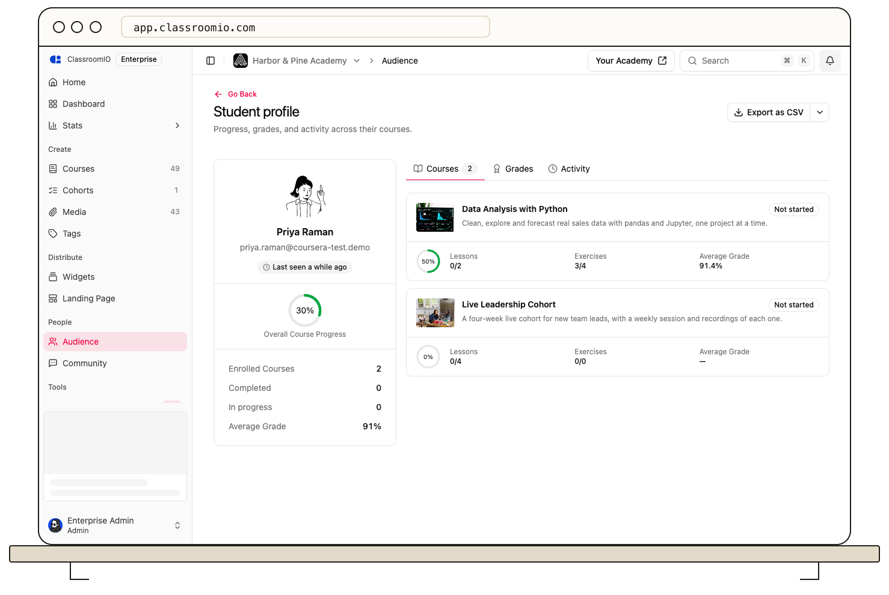

Select a student’s name in **Audience** to open their profile. Use the profile summary, **Courses**, and **Grades** to review their learning across the organization.

## Open a profile

Organization administrators open **Audience**, search for the student, and select their name. Pending invitations without a student account do not have a full learning profile yet; [review the invitation](/manage-learners/manage-pending-invitations) instead.

If the profile fails to load, select **Retry**. Confirm that you are in the correct organization if the expected student is missing.

## Read the summary

The profile rail shows the student's name and email, last-seen indicator, overall course progress, enrolled and completed course counts, and average grade. Use these together: a student can submit exercises while their lesson completion remains at zero.

## Review courses and grades

Under **Courses**, review each course's progress percentage, completed lessons, completed exercises, average grade, and completion status. Select a course title to open that course.

Under **Grades**, expand a course to inspect its exercises and submission or grading status. Where an exercise link is available, open it to review the student's submission. A missing grade does not necessarily mean a zero score; the work may be unsubmitted or awaiting grading.

For a course-specific view available to the teaching team, use [Review a student's course progress](/manage-learners/review-a-learners-course-progress).

## Check activity indicators

Use **Last login** and **Last activity** in [Audience](/manage-learners/browse-search-and-filter-your-audience) to find students who may need follow-up. They represent different events, so a recent login does not prove the student studied course content.

The profile's **Activity** tab currently shows **Activity timeline Coming soon**. A detailed lesson-completion and exercise-submission timeline is not available there yet.

## Export a record

Use **Export as CSV**, or the adjacent format menu, to download the profile report. Keep student exports in a location appropriate for personal and learning records.
