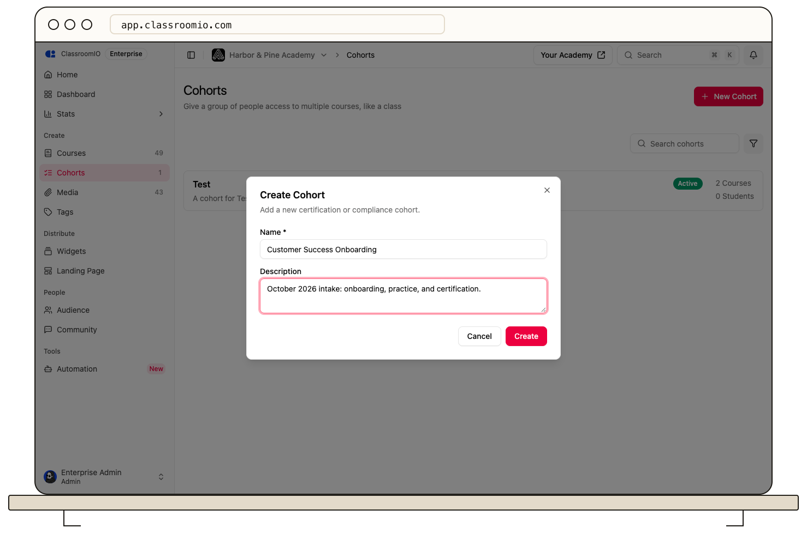

Open **Cohorts → New Cohort**, enter a name and description, and select **Create**. Then add the courses and people who belong to that group.

## Before you start

Organization administrators can create cohorts. Decide which students should share the same courses and learning targets. A cohort links existing courses rather than duplicating them; [learn how cohorts work](/reference/cohorts) before using one for a new intake.

## Create the group

### 1. Open New Cohort

From the organization sidebar, select **Cohorts**, then **New Cohort**.

### 2. Enter its details

In **Create Cohort**, enter a recognizable **Name**, such as `Customer Success Onboarding — October 2026`. Add a **Description** that explains the group's purpose, then select **Create**.

The cohort opens with its own **Newsfeed**, **Courses**, **People**, and **Settings** pages.

### 3. Add courses

Open **Courses → Add Course** and select existing courses. See [Add courses to a cohort](/manage-learners/add-courses-to-a-cohort) for enrollment and publishing behavior.

### 4. Add members

Open **People → Invite** to add students, invite people by email, or create a reusable invite link. [Assigning students to the cohort](/manage-learners/assign-learners-to-a-cohort) also gives them access to its linked courses.

## Finish setup

Open **Settings** to review the name, description, and status, and [configure learning goals](/manage-learners/configure-cohort-goals-and-settings). Use the **Newsfeed** to [post a welcome update](/manage-learners/post-to-a-cohort-news-feed) when the group is ready.

Before inviting real students, test with a demo member and confirm that the intended courses are published and visible in their LMS.
