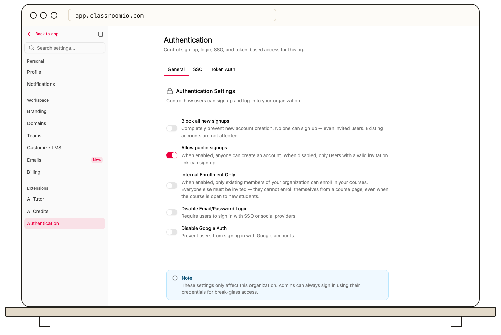

Organization signup policies control who can create an account, while course enrollment controls decide how students join a course. Review both before opening or restricting access.

## Set organization policies

Organization administrators open **Settings → Authentication → General**. Review the following controls before saving:

- **Allow public signups:** On allows anyone to create an account. Off requires a valid invitation link to sign up.
- **Internal Enrollment Only:** On limits normal course self-enrollment to existing organization members. Invite outsiders when you want them to join.
- **Block all new signups:** Prevents new account creation, including invited students. Existing accounts are unaffected.

The first two controls require an Early Adopter or Enterprise plan, or a self-hosted installation. Blocking all new signups is an Enterprise control in the hosted app. A lock beside a control indicates that your current plan cannot change it.

:::warning[Check invitations before blocking signups]
A new student cannot create an account while **Block all new signups** is on, even when they have an invitation. Use this setting only when that is the intended result.
:::

Select **Save changes** after reviewing your choices. These policies apply to the current organization.

## Set course access

Open course **Settings → Access**:

- Turn **Students can enroll themselves** on for normal free-course enrollment, or off when students should receive access from your team.
- Turn **Publish Course** on when students should be able to see and open the course. Review lesson and exercise locks separately.

A paid course cannot use the normal free self-enrollment path. [Verify payment and grant access](/manage-learners/enroll-learners-in-a-paid-course).

## Choose an access policy

For open enrollment, allow public signups, turn off internal-only enrollment, and enable self-enrollment on the published free course.

For an internal academy, enable **Internal Enrollment Only**. Existing organization members can join courses that allow self-enrollment; outsiders need an invitation.

For invitation-based access, turn off course self-enrollment and distribute invitations only to intended students. Review [reusable invite links](/manage-learners/invite-learners-with-a-reusable-link), because anyone holding an active link can join.

## Test with a student account

Use a separate demo student to check signup, enrollment, and published content. An administrator's access does not prove what a student can open. To revoke an existing student's access, [remove their course membership](/manage-learners/add-and-remove-people-from-a-course) or [manage their organization membership](/manage-students/find-and-remove-inactive-students).
