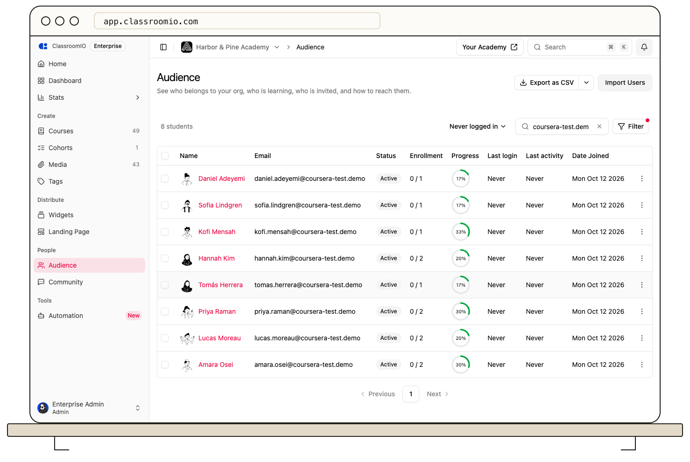

Use **Audience** activity filters to find inactive students, review their records, then archive or deactivate selected memberships. Archive when you need to free student seats while keeping a record.

## Find students to review

Organization administrators open **Audience** and select **Inactive 90+ days**, **Inactive 180+ days**, or **Never logged in** from the view menu. You can also combine **No login in**, **No activity in**, enrollment, and completion filters.

Keep **Exclude recent joiners** on unless you deliberately want to include students who joined within the selected inactivity period. A student with no recorded login is not necessarily an abandoned account; check when they joined and what they were assigned.

Open individual [student profiles](/manage-learners/view-a-learner-profile-and-activity) when the record needs more context. [Export the filtered list](/manage-learners/export-your-audience) before changing access if you need an audit copy.

## Choose the right action

- **Archive:** removes organization access, preserves the membership record, and frees the student seat.
- **Deactivate:** removes organization access and preserves the record, but continues to count the seat.
- **Reactivate** or **Unarchive:** restores access. Unarchiving needs an available student seat.

## Apply a membership change

### 1. Select and review

Select student rows. The header checkbox selects the current page; use the displayed option to select all matching filtered results only if that is your intent. Check the total before continuing.

### 2. Confirm the action

Open **Actions**, choose **Archive** or **Deactivate**, and review the confirmation count. Enter the requested confirmation and an optional reason, then confirm.

If the matching audience changed after preview, refresh and review the selection again. For a large background operation, keep the tab open to see its result.

### 3. Check the result

Review changed and skipped records. The page offers **Undo** for archive and deactivate actions for up to 15 minutes while you remain on the page. Undo does not overwrite a later membership decision. Reactivate, unarchive, and delete do not have the same undo option.

## Permanently delete a membership

:::danger[Delete only after reviewing the consequences]
Bulk deletion is permanent and requires the membership to be archived first. It removes the organization membership and associated course membership and completion records. It does not delete the person's global account or all lesson progress.
:::

Open the **Archived** view, select the intended records, open **Actions** and choose the **Delete … students** option, and complete the confirmation. Use archive instead when you need to keep the organization's student record.

## Related guides

- [Browse and filter your audience](/manage-learners/browse-search-and-filter-your-audience)
- [Add and remove people from one course](/manage-learners/add-and-remove-people-from-a-course)
