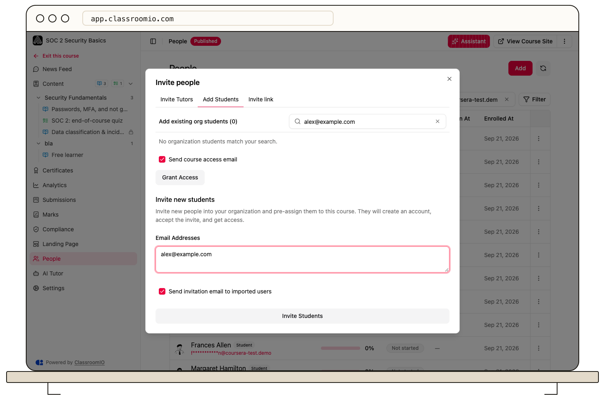

Open a course’s **People** page, select **Add → Add Students**, and enter email addresses under **Invite new students**. New students accept the invitation to join your organization and access the course.

## Before you invite

Administrators and tutors with course access can invite students. Organization administrators can also browse existing organization students; tutors invite by email without browsing the full audience.

Check available student seats and [signup policies](/manage-students/enrollment-access-control). **Block all new signups** prevents new account creation even for invited students. Publish the course before students need to open its content.

:::warning[Invitations grant access]
For a paid course, confirm payment first. An invitation grants access without collecting the course price.
:::

## Send invitations

### 1. Open the invitation form

Open the course, select **People**, then **Add**. Select **Add Students** and find **Invite new students**. Administrators may need to scroll past the existing-student picker.

### 2. Enter recipients

Enter the students' email addresses in **Email Addresses**, separated by commas, newlines, or semicolons. Check the spelling and use the addresses students will sign in with.

Keep **Send invitation email to imported users** selected if students should receive an invitation now. If you turn it off, ClassroomIO does not send the invitation email; arrange the student's join instructions separately.

### 3. Invite and review

Select **Invite Students**. Review the result for skipped addresses, seat limits, or email failures. A successful import and a successfully sent email are separate outcomes.

New students accept their invitation and create an account if needed. Existing organization students can receive course access directly. [Manage pending invitations](/manage-learners/manage-pending-invitations) from **Audience** when a student has not joined.

## Invite a larger list

Use [CSV import](/manage-learners/import-learners-from-a-csv-file) when you need row-by-row validation or want to assign multiple courses or cohorts. To share one link yourself, use [a reusable invite link](/manage-learners/invite-learners-with-a-reusable-link).
