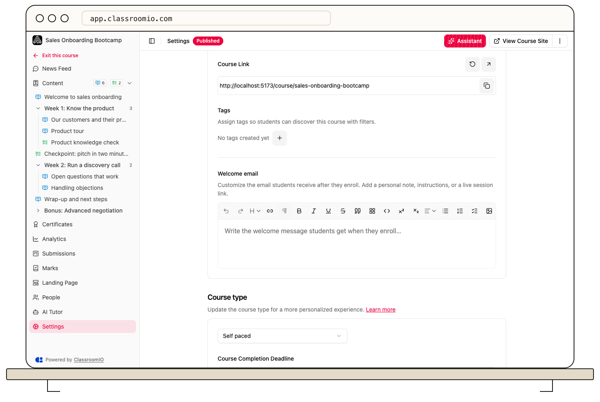

Write a course-specific **Welcome email** in the course’s **Settings**, then save it for future enrollments. Use the message to explain how to start and what students should expect.

## Write the welcome message

### 1. Open the editor

Open **Courses**, choose the course, and select **Settings**. Find **Welcome email** under **General**. Administrators and tutors with course access can edit the message.

### 2. Compose the message

Write your welcome text in the rich-text editor. Include the next action students should take, useful course instructions, and links they can access.

Keep the message suitable for everyone who enrolls. Do not paste a particular student's private details into a course-wide email.

### 3. Save for new enrollments

Select **Save changes**. The saved message is used when new students enroll. Editing it does not resend the welcome email to existing students.

To use the default welcome wording again, clear the course-specific message and save. To change the organization-level subject or default wording, see [Customize student emails](/publish-and-brand/customize-student-emails).

## When the message is sent

The welcome email is queued when a student enrolls, including self-enrollment, accepting an invitation, and supported direct-enrollment flows. Sending an invitation is a separate step; the course welcome belongs to enrollment rather than merely receiving an invite.

Your message appears in the welcome email alongside ClassroomIO's course access action. Formatting is cleaned for email delivery, so check links and avoid relying on elaborate styling.

Test with a new demo student's enrollment when you need to verify the message. This sends a real email; use an address you control and confirm the course and enrollment settings first.

## Live class calendar invites

For a **Live class** course with an upcoming scheduled lesson session, the welcome can include a calendar invite for the next session. This depends on the session's schedule and join link, not on pasting a date into the welcome editor.

Use [Run a live class](/create-and-deliver/live-class) to configure the session and [Create a live class course](/build-courses/create-a-live-class-course) for the overall setup.

## If the message does not arrive

Confirm that the demo student actually enrolled rather than only receiving an invitation. Check the recipient address and spam folder. Reopening the course or changing the welcome message is not a resend action.

## Related guides

- [Publish a course and allow self-enrollment](/build-courses/publish-a-course-and-allow-self-enrollment) — decide how students join
- [Invite students](/manage-students/invite-students) — use invitations for controlled access
- [Customize student emails](/publish-and-brand/customize-student-emails) — edit organization-level email wording
- [Run a live class](/create-and-deliver/live-class) — provide the session used for calendar invites
