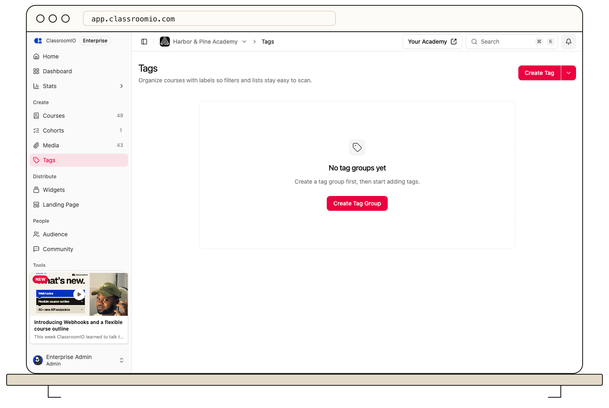

Tags help students and course managers find courses by topic, level, or another category. Create tag groups and tags from **Tags**, then assign them in each course’s **Settings**.

## Who can manage tags

Organization administrators create and edit tag groups and tags. Tutors can assign existing tags to courses they manage. Students can use the course catalog's tag filters without editing the tags.

## Create groups and tags

### 1. Open Tags

In the organization dashboard, open **Tags** under **Create**. A tag group is a category such as “Topic” or “Difficulty”; a tag is a value such as “Security” or “Beginner.”

### 2. Create a tag group

Select **Create Tag Group** in the empty state. If tags already exist, open the menu beside **Create Tag** and choose **Create Tag Group**. Enter **Group Name**, optionally add a description, and select **Save**.

You need a group before you can create its tags.

### 3. Create a tag

Select **Create Tag**, enter **Tag Name**, and optionally add a description. Choose its group under **Category**, select a color, and select **Save**.

Use the row's actions to edit a tag or group later. Check the associated courses before changing labels students already use.

## Assign tags to a course

### 1. Open the tag picker

Open the course's **Settings** and find **Tags** under **General**. Select **Add tag**.

### 2. Select and save

Select tags from the grouped picker. Select an existing choice again to remove it, or remove its chip. A course can have tags from several categories.

Select **Save changes** to apply the course settings. Creating a tag alone does not assign it to any course.

## Find tagged courses

On **Courses**, use the tag filter to narrow the list. The public course catalog also provides a **Filter** panel with tag choices.

On the **Tags** page, select a tag's **Total Courses** count to open the courses associated with it. Use this before editing a label to check where it is used.

Tags organize discovery; they do not enroll students, unlock content, or change course permissions.

## Related guides

- [Tags](/reference/tags) — understand scope and ownership
- [Update course details and cover image](/build-courses/update-course-details-and-cover-image) — finish the course presentation
- [Roles and permissions](/organization-and-team/roles-and-permissions) — check who can manage your organization
