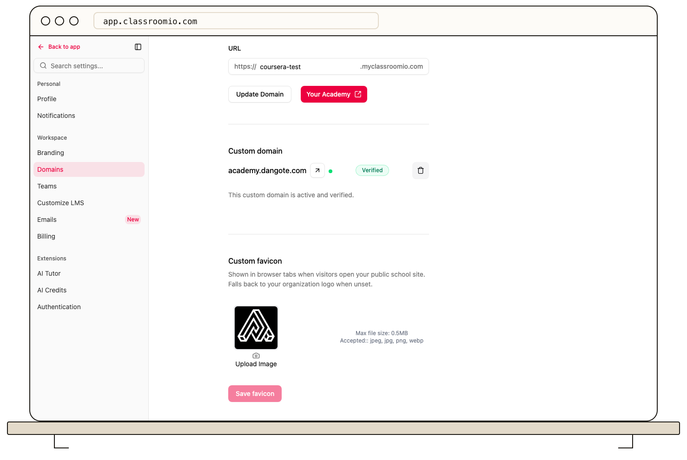

A custom favicon helps students recognize your academy in browser tabs and bookmarks.

1. Open **Settings → Domains**.
2. Find **Custom favicon**, upload an icon, and save it.
3. Open your academy site in a new tab to check the result. Browser icon caches can take time to refresh.

The **Custom code** area on this screen is marked **Coming soon** and cannot be configured here today. For how the icon and link previews work when sharing your academy, see [Share Your Academy](/publish-and-brand/academy-sharing-and-branding).
