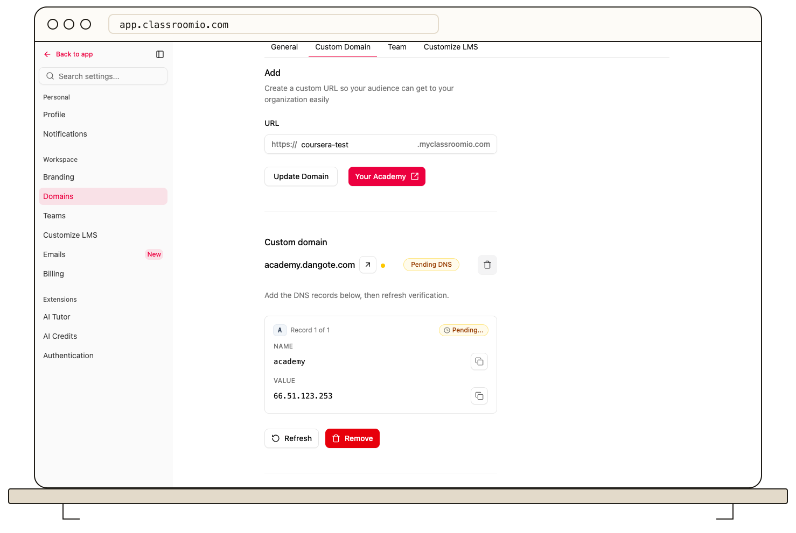

ClassroomIO shows the DNS records needed for the specific hostname you connect.

1. Open **Settings → Domains**, enter your custom hostname, and choose the connect action.
2. In the setup panel, copy each record's **Type**, **Name**, and **Value** exactly as displayed.
3. Add those records at the DNS provider that manages your domain. If your provider uses `@` for the root, follow the record name ClassroomIO displays for your hostname.
4. Return to ClassroomIO and refresh the domain status after the records are saved.

DNS changes can take time to propagate. Keep the setup panel's values as your source of truth; they may differ by hostname. See [Verify your domain and SSL certificate](/publish-and-brand/verify-your-domain-and-ssl-certificate).
